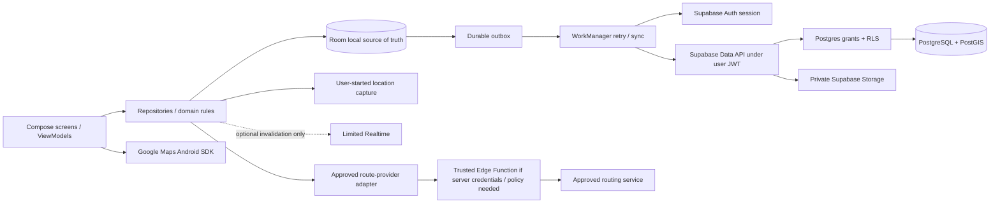

# FIELD EYE V1.1 — Technical Architecture and Feasibility

**Status:** Revised for the authoritative project-owner decisions dated 13–14 November 2026 and the official-source technical audit completed 14 November 2026. The bounded Phase 1 recommendation is limited as defined in §10; later capture, sensitive-data, backend, provider and sync work remains gated by owner and technical approvals.
**Project phase:** PRE-DEVELOPMENT — TECHNICAL ARCHITECTURE REVIEW
**Prepared:** 14 November 2026
**Scope:** Architecture and feasibility documentation only. This document does not authorize an Android implementation, Supabase project/schema, Google Cloud configuration, service activation, deployment, paid API use, or credential creation.

## Decision status and interpretation

This document separates supplied decisions from engineering recommendations and unresolved approvals. The project-owner addenda dated 13 and 14 November 2026 are authoritative and override conflicting assumptions in earlier drafts: locked-screen session recording is required; independent sessions may run simultaneously on multiple devices for one account; attachments are included in V1 but their product policies remain open; session start is blocked if the required persistent foreground-service notification cannot be displayed; opportunity scoring remains explicitly undecided. A recommendation is not an owner decision. No schema, API contract, attachment format/limit, provider, retention period, or implementation detail becomes approved merely by appearing here.

- **Already approved / specified:** owner-provided direction or requirement, as listed in the existing product brief and the new owner-provided architecture assignment.
- **Recommended:** a proposed design to review. It should be adopted only after project-owner approval and detailed implementation review.
- **Unresolved — owner approval required:** a product, privacy, security, provider, or cost choice that this document deliberately does not settle.

The owner-provided assignment states that the V1 UI/UX screenshots and prototype have been reviewed and approved and that the project is moving into architecture. That authorizes architecture research and documentation, not application or backend implementation.

## 1. System architecture

### 1.1 Approved direction and recommended topology

**Already approved / specified:** native Android with Kotlin, Jetpack Compose and MVVM; Room; WorkManager; Google Play services Location APIs; Supabase Auth, PostgreSQL, PostGIS, Storage, limited Realtime and Edge Functions for trusted operations; Google Maps Platform. V1 is for individual agents and private personal records. Local-first session and visit capture, user-controlled tracking, timestamped and accuracy-aware location observations, duplicate-safe synchronization and privacy boundaries are requirements. Multiple installations under one account may record independent sessions concurrently; session ownership and synchronization are account-scoped, with each session retaining a stable identifier and originating-installation provenance.

**Recommended:** keep the V1 system a small client-server application. Room is the Android read source of truth. Supabase Postgres is the authenticated cloud source of truth after synchronization. A narrow HTTPS/API boundary carries user-scoped data operations. Use Edge Functions only for operations that genuinely require trusted server-side policy, provider credentials, or atomic validation that must not be entrusted to a client. Do not make Realtime part of the correctness path for sync.

The diagram shows logical boundaries, not configured services. It does not imply that project resources, keys, functions, tables, or billing are enabled.

**Why:** Android's recommended offline-first approach keeps the database as the local source of truth and has repositories reconcile local and network sources. Supabase explicitly separates public client keys from server-only secret keys and describes RLS as the row-level authorization layer. A simple, scoped architecture therefore supports offline work without trusting the device with privileged credentials. [1] [4] [13] [14]

### 1.2 Component responsibilities and data flows

- **Compose UI / ViewModels:** render immutable screen state; send user intents to repositories/use cases; expose GPS, sync, freshness and evidence states. No screen calls Supabase, Room DAOs, a map route web service, or provider SDK directly.
- **Domain calculations:** pure deterministic rules for session duration, track-distance derivation, completeness and other owner-approved metrics. Every derived value identifies its source records and method version. Missing inputs remain unavailable rather than becoming zero.
- **Repositories:** coordinate Room and the network; publish Room-backed flows; commit user edits locally; translate server DTOs to local/domain models; manage sync status and conflict visibility.
- **Room:** durable local personal records, cached allowed reference data, sync metadata and outbox. Domain and UI read from Room rather than racing a network response against a local screen.
- **Location foreground service:** starts only from a visible, explicit user action after the required foreground location permissions and device location checks. It owns ongoing sampling across screen lock/background transitions, writes accepted samples to Room, and maintains a truthful persistent tracking notification. It is not restarted after user force-stop or reboot; system process-death recovery is best-effort and gaps remain gaps.
- **WorkManager:** drains the durable per-installation/account outbox and attachment upload queue, retries transient work, and reconciles remote updates. It is not the continuous GPS sampling engine and it cannot promise a precise execution time.
- **Supabase Auth:** identifies the signed-in person and issues the user JWT used by the Data API, Storage and user-authorized functions. An application-level publishable key identifies the mobile app but does not authenticate an individual user. [12] [13]
- **Supabase Postgres/PostGIS:** validates and persists canonical user records; enforces constraints, ownership and geospatial queries through SQL, grants and RLS. The app sends minimal fields and bounded queries.
- **Supabase Storage:** private object store for V1 attachments. Each object has a generated user/attachment-scoped path and an owner-authorized policy. A personal `attachments` row records parent linkage and object state; binary transfer and metadata sync are separate, restartable steps. Storage is never made public to simplify downloads. [17]
- **Supabase Edge Functions:** narrow trusted boundary for provider calls, rate limits or cross-row operations that need a server secret. User-facing handlers should validate the user JWT and use a user-RLS-scoped client wherever possible. Any privileged client must explicitly constrain rows to the JWT subject. [18]
- **Realtime:** optional UX invalidation for limited server-originated changes. On reconnect, the client still performs an authenticated reconciliation/query; event delivery does not replace durable sync, idempotency or retry state. Supabase documents per-subscriber authorization and scaling considerations for Postgres Changes. [19]
- **Google Maps Android SDK:** renders a map, markers, polygons, gestures and overlays. It does not itself calculate a route. Route computation is a separate provider adapter behind a reviewed interface. [21] [22]

### 1.3 Recommended request paths

**Personal record sync:** Room outbox → WorkManager → Supabase Data API with the signed-in user's JWT and publishable key → Postgres constraints/RLS. Use the Data API only for narrow authenticated records. Use a dedicated, reviewed RPC/Edge Function for operations requiring atomic multi-row validation or provider secrets; do not create a general-purpose privileged proxy.

**Reference-data read:** bounded query by viewport, time range and result limit, with paging if needed. Cache only content whose provider and license allow local storage. For map viewport queries, use PostGIS spatial predicates/indexes. [16]

**Route request:** `RouteProvider` interface in the app → approved implementation. Before service choice, determine whether route calculation is called directly using a compatible restricted client credential or through a trusted server function. The endpoint must accept only a constrained request model, validate authentication and quotas, select a fixed provider/field mask, and reject arbitrary URLs/fields. Do not forward a Google service key to the app. Policy and storage restrictions for route response data must be reviewed first. [23] [24] [25] [26]

**Attachment upload:** copy the selected/captured file into app-private durable storage, create the attachment metadata and parent association locally in one transaction, then enqueue metadata and binary upload. Sync the parent before its attachment metadata; upload to a private owner/attachment-derived path; use resumable upload for files above the standard-upload range or unstable connectivity. The upload is idempotent and never overwrites another attachment. Never treat a public URL as authorization. [27] [35]

## 2. Android application architecture and module boundaries

### 2.1 Presentation and state

**Recommended:** MVVM with unidirectional data flow. Each screen ViewModel exposes a single immutable UI state (including loading/empty/error/evidence/sync values) and accepts explicit UI events. State is derived from repository flows that read Room. One-shot navigation/snackbar effects are separate from durable screen state. ViewModels do not own long-lived location tracking; the session/location component owns that lifecycle and exposes persisted state.

Use Compose navigation destinations for the five approved primary tabs: **Home, Map, Activity, Analytics, Profile**. Registration, login, permission education, place/neighbourhood detail, route planning, active session and visit recording are secondary flows, not new primary tabs.

### 2.2 Module/package boundaries

**Recommended initial modularity:** begin with a small Gradle structure rather than a Gradle module per screen. Android guidance cautions that excessive granularity adds build configuration and maintenance overhead, particularly for small projects. [2]

- `:app` — application entry point, navigation, dependency graph, Compose theme, feature screen packages and ViewModels.
- `:core:model` — platform-neutral record/domain types, evidence states and calculation contracts. Do not duplicate Room entities as public domain contracts.
- `:core:data` — repository implementations and contracts, local/remote mappers, Supabase transport, sync coordination and error mapping. It may initially be one Gradle module with internal packages `local`, `remote`, `repository` and `sync`.
- `:core:location` — permission state, capture policy, location callback/service boundary and sample validation. It owns no UI navigation.
- `:core:maps` — Google Maps surface adapter, map model mapping and the route-provider interface; provider implementation is injected only after approval.

Keep feature code under `:app` packages initially: `feature.home`, `feature.map`, `feature.activity`, `feature.analytics`, `feature.profile`, `feature.auth`, `feature.session`, `feature.visit`, `feature.search`, `feature.route`. Split a package into a standalone Gradle module only when tests, dependency isolation, build-time, ownership or reuse provides a measured benefit. Room storage may remain in `:core:data` initially; split `:core:database` or `:core:sync` later if needed.

**Dependency rule:** UI → domain/repository interfaces → data implementations → Room/Supabase/provider SDKs. The dependency direction should not make `:core:model` depend on Compose, Android location classes or Supabase DTOs. Cross-screen workflows use use cases only when business logic is shared or nontrivial; do not add an elaborate domain layer by default. [1] [2]

### 2.3 Feasibility notes

- **Feasible in the approved stack:** local persistence, screen state, user-triggered location, post-hoc personal analytics and a retryable network outbox.
- **Feasible after policy/provider design:** continuous user-visible recording while minimized; Google map display; route requests; private media upload; spatial search.
- **Not established:** offline Google basemap tiles, offline route computation, turn-by-turn navigation, a neighbourhood boundary source, or reliable network signal metrics across Android devices/carriers. **Opportunity scoring is undecided, not silently excluded or included**; do not display a score or claim the capability until the owner selects a V1 option and its evidence requirements are met.
- **Supabase Kotlin client choice:** select a maintained Kotlin client or a small HTTP/Data API client after compatibility, security, session-refresh and lifecycle evaluation. Do not assume that all Supabase JS features or APIs have a one-to-one native Kotlin implementation. The project has approved Supabase as backend, not a specific Android SDK.

## 3. Data model

### 3.1 General storage rules

**Recommended:** generate stable UUIDs on-device before a record is queued. Use `uuid` primary keys in Postgres and the same string/UUID locally. Use UTC instants (`timestamptz`) for wall-clock events, preserve source/capture timestamps separately from server receipt timestamps, and retain reported location accuracy in metres. Store geographic points as `extensions.geography(Point, 4326)` when distance-on-Earth semantics are required; use `geometry` only for explicitly projected planar operations. PostGIS provides indexable spatial types and GiST spatial indexes; Supabase recommends installing PostGIS into a dedicated schema such as `extensions`, not `public`. [16]

Every personal record is account-owned (`owner_id uuid` referencing `auth.users(id)`) and where device-originated, carries a non-secret installation identity for provenance. A single account can have records created by multiple installations; no device is globally authoritative. Use same-owner composite keys/foreign keys or validated server operations so a child cannot reference another owner's parent. Define `created_at` and `updated_at`; for observations also define `captured_at` and server `received_at`. Never conflate client capture time with cloud receipt time. Store explicit data-quality/status fields rather than fake values. Any server-issued change cursor and tombstone contract must be defined independently of client clocks. Any server-issued change cursor and tombstone contract must be defined independently of client clocks.

Room is partitioned by authenticated `owner_id` and local installation identity. It has local `sync_state` (`local_only`, `pending`, `syncing`, `synced`, `retry_required`, `conflict`, `blocked_auth`), upload state, `last_sync_error_code` and a monotonic local revision. These operational fields do not have to be mirrored into canonical cloud records. The cloud schema should be designed through migrations only after approval; this document creates no DDL.

### 3.2 Proposed entities and important fields

The following are architecture proposals, not approved DDL. V1 records belong to the signed-in account; device/install identity describes where an action originated and is not an authorization substitute.

- **`profiles`** — `id uuid` primary key and foreign key to `auth.users(id)`; display name and optional user-entered profile values; created/updated timestamps. Keep authentication secrets and server-managed Auth attributes out of this table. Do not use editable user metadata for authorization. [12] [15]
- **`user_settings`** — `owner_id uuid` primary key; theme/map preferences; approved sampling preferences; settings schema version; updated timestamp. Keep permission grants and runtime service state in Android platform state.
- **`device_installations` (recommended account-level registry)** — `id uuid` random app-installation GUID, `owner_id`, optional user-editable label, app version, created/last-seen timestamps, optional retired/revoked timestamps. Create a new ID per app installation and account binding; do not use IMEI, serial, MAC, or a hardware fingerprint. Store the current installation ID outside Android Auto Backup so a restore/reinstall cannot clone the active installation identity; restored records retain historical origin metadata while new outbox operations identify the current submitting installation. Treat IDs as provenance, not proof of device integrity. Whether to expose device listing/revocation UI is a product approval. A bare client-supplied installation UUID cannot enforce server-side revocation; see the multi-device security caveat below. [11]
- **`neighborhoods`** — shared reference record if a dataset is approved: dataset/source ID, source version, source attribution/license, stable neighborhood key, display label, `boundary extensions.geometry(MultiPolygon, 4326)` or appropriate geometry, source effective time and import time. It is not user-owned if globally licensed reference content. Dataset choice and license are blockers.
- **`places`** — user-owned saved places: `id`, `owner_id`, label, optional user note/category, optional `location geography(Point,4326)`, reported input accuracy/source, captured/created/updated times, optional external provider ID only if its terms allow retention. Keep provider-supplied content distinct from user-authored notes and saved references.
- **`field_sessions`** — `id`, `owner_id`, `created_by_device_id` (installation UUID), status (`recording`, `paused`, `completed`, `interrupted`), start/end UTC timestamps, accumulated active duration, optional chosen `route_plan_id`, local monotonic-clock/boot provenance, finalization revision and created/updated timestamps. Client generates the UUID before offline use. The account may have multiple sessions, including concurrent recording sessions on different installations; each sample belongs to exactly one session.
- **`location_samples`** — `id`, `owner_id`, `field_session_id`, `created_by_device_id`, `captured_at`, optional device monotonic elapsed-realtime value and boot/session discriminator, `position geography(Point,4326)`, required `horizontal_accuracy_m`, optional altitude/vertical accuracy/speed/bearing only when supplied and meaningful, source/provider and validation flags. Append-only; do not thin or mutate raw samples silently.
- **`visits`** — `id`, `owner_id`, `created_by_device_id`, optional `field_session_id` and `place_id`, `recorded_at`, optional approved visit start/end, optional location and accuracy/time provenance, approved user-entered outcome code, notes, record revision and timestamps. Saving offline must not depend on network.
- **`route_plans`** — `id`, `owner_id`, `created_by_device_id`, user-intended origin/destination references or coordinates, travel mode, selected route label and status. Provider response content stays transient unless terms explicitly permit storage.
- **`route_points`** — user-entered ordered waypoints for a saved route plan (`id`, `owner_id`, `route_plan_id`, sequence index, point kind, coordinate/place reference). Provider-returned encoded polyline is not stored by default. Raw GPS belongs in `location_samples`.
- **`network_measurements`** — `id`, `owner_id`, `created_by_device_id`, optional session ID, `measured_at`, optional location and horizontal accuracy, device/network context only to the extent Android APIs and privacy review permit, nullable metrics with units and measurement source. Null means unavailable/unmeasured, never zero.
- **`opportunity_assessments` (scope undecided)** — optional derived record if the owner selects scoring for V1: `id`, account or explicitly approved dataset scope, neighbourhood/source version, nullable score and evidence state, deterministic method/version, assessment time, freshness window, input record/dataset references, minimum-sample status and human-readable explanation. No scoring algorithm, provider or deployment is approved by this draft.
- **`attachments`** — `id uuid`, `owner_id`, `created_by_device_id`, nullable `parent_visit_id` and nullable `parent_field_session_id` (exactly one must be set), immutable object key, bucket, detected MIME type, byte size, checksum, capture/creation time, optional derivative/provenance metadata if derivatives are approved, local path/state, remote upload state, upload-session expiry metadata (never an auth token), retry count, created/updated timestamps and deletion tombstone. Use real same-owner foreign keys to the supported parent tables rather than an unconstrained polymorphic parent UUID. A visit- or session-linked attachment is saved locally atomically with its parent reference before any network operation. Binary objects and metadata have separate states and recovery procedures. Keep local attachment bytes in app-specific internal storage, not shared storage; exact encryption/key lifecycle and backup inclusion remain decisions. Supported formats and size limits are open product decisions; validate against the policy only after owner approval. [17] [27] [35] [56]

**V1 attachment requirement — product policy not yet approved:** attachments are included in V1, but no supported file types, file/count/aggregate size limits, capture/import UX, EXIF treatment, derivative/original handling, or retention period is approved. Do not treat any earlier proposed types, caps, or metadata transformations as owner decisions. Define those policies with the owner before implementation; provider limits and security validation are separate technical constraints. Once policy is approved, validate actual file signatures/MIME and size after copying into app-private storage rather than trusting a picker filename or client-supplied MIME. Do not silently alter source files; any approved derivative behavior must preserve provenance and be disclosed.

- **`sync_operation_receipts` (recommended server-side idempotency ledger):** uniquely key each accepted mutation by `(owner_id, operation_id)` and store the entity/type, immutable payload hash, canonical result/revision reference and server acceptance time. An exact replay returns the prior canonical result; reuse of an operation ID with a different payload hash conflicts. Keep mutation-operation identity separate from entity UUID identity. Do not store credentials or duplicate sensitive payloads in the receipt. Retention/replay horizon is an owner decision; do not purge receipts before the approved offline/retry horizon or a full resynchronization path is available. This remains a proposal, not approved schema. [53] [54]

- **`sync_operation_receipts` (recommended server-side idempotency ledger):** uniquely key each accepted mutation by `(owner_id, operation_id)` and store the entity/type, immutable payload hash, canonical result/revision reference and server acceptance time. An exact replay returns the prior canonical result; reuse of an operation ID with a different payload hash conflicts. Keep mutation-operation identity separate from entity UUID identity. Do not store credentials or duplicate sensitive payloads in the receipt. Retention/replay horizon is an owner decision; do not purge receipts before the approved offline/retry horizon or a full resynchronization path is available. This remains a proposal, not approved schema. [53] [54]

### 3.3 Important relationships and indexes

- `profiles.id` and `user_settings.owner_id` identify the Auth account. A `device_installations` row is owned by one account; an installation re-bound after sign-out must not retain access to the previous account's local partition.
- `field_sessions.owner_id` owns samples, visits and attachments. Each child carries the same `owner_id`; enforce both owner and parent relation at the database boundary. `created_by_device_id` records historical origin where known and is not required to be the current submitting installation; the outbox's `device_installation_id` identifies the installation submitting that operation.
- An attachment references exactly one supported visit or field session by a real same-owner FK. Parent deletion first creates a deletion/tombstone workflow for related attachment metadata and Storage objects; cascading database metadata alone must not strand Storage binaries.
- Shared `neighborhoods` are reference rows; user activity links to stable dataset key/version rather than changing shared geometry.
- Add B-tree indexes beginning with `owner_id` on personal tables and composite indexes for common owner/time reads. Add `(field_session_id, captured_at)` for sample reconstruction, `(owner_id, created_by_device_id, status)` for device session state, `(owner_id, parent_visit_id)` for visit attachments, and GiST indexes for map queries. Index RLS filter columns. [14] [16]
- Stable UUIDs are globally unique idempotency identities; enforce unique record IDs and same-owner composite references. Do not rely on device-local auto-increment IDs.
- Add check constraints for allowed states, valid parent kind, exactly one parent, nonnegative file size, owner-approved supported MIME values and session lifecycle. Enforce any owner-approved file/count/aggregate limits on both client and server; no product limits are approved yet.
- Use keyset pagination for large activity/sample reads and a bounded time/window or viewport for maps. Account-wide change sync requires a server-defined change-feed contract that cannot skip commits across pages: its cursor position must follow committed/visible change order, not merely a sequence value or client capture timestamp that can be allocated before transaction commit. Specify how the feed prevents advancing past an earlier transaction that becomes visible later (for example, a serialized transactional log/watermark or a consistent server snapshot token); prove the selected mechanism in tests. Include deletes/tombstones in the same feed and advance a client cursor only in the same local transaction that applies the complete page. A timestamp/UUID tie-breaker or ordinary non-transactional database sequence alone does not create a stable snapshot across separate Read Committed requests. On cursor expiry, invalidation or retention gap, stop incremental sync and perform an owner-scoped full resnapshot/reconciliation before resuming. Define tombstone and receipt retention against an owner-approved maximum offline/replay horizon; before purge, require devices beyond that horizon to resnapshot and prove they cannot resurrect deleted rows. [52]

## 4. Offline-first synchronization and conflict handling

### 4.1 Local write and outbox

**Recommended:** every user action first commits both the local domain record and its outbox operation in one Room transaction. The UI acknowledges “Saved on this device” only after that transaction succeeds. Network failure changes sync state, not the record's existence.

Proposed outbox row fields: `operation_id UUID`, `owner_id UUID`, `device_installation_id UUID`, `entity_type`, `entity_id UUID`, `operation_kind`, `payload_version`, `local_revision`, `created_at`, `attempt_count`, `next_attempt_at`, `state`, and a bounded non-sensitive error code. Attachment metadata operations and object-upload tasks are separate durable queue entries linked by `attachment_id`; never put binary data, signed upload URLs or auth tokens in the outbox. Store a row reference or a versioned immutable payload snapshot.

On reconnect or explicit retry, enqueue uniquely named WorkManager tasks within this installation, keyed by account and queue class (for example `field-eye-sync:<user-id>` and `field-eye-attachments:<user-id>`). WorkManager uniqueness is local to that Android installation, not a cross-device lock. The server must provide account-scoped idempotency and concurrency control. Workers may be delayed/stopped; correctness cannot assume immediate or uninterrupted execution. Do not rely on `ExistingWorkPolicy.KEEP` alone as the durable wake-up protocol: a new enqueue may be ignored while same-named unfinished work is running, including near its final empty-queue check. The implementation must use a race-safe durable retrigger/drain handshake: persist pending work first, drain bounded batches, recheck durable queue state as part of completion, and guarantee a successor attempt is scheduled when work arrived during shutdown; retain startup/reconnect/manual-retry reconciliation as fallback. Select the exact WorkManager policy/chaining strategy only after testing. [5] [6]

### 4.2 Proposed synchronization sequence

1. Check current authenticated user and compare it to the outbox's `owner_id`. Never send one account's pending rows with another account's JWT. If signed out/expired, mark or leave work `blocked_auth` and prompt the user to reauthenticate.
2. Claim a bounded batch in deterministic order. Parent rows (session, place or route plan) precede dependent rows. For an attachment, sync its parent and attachment metadata first, then upload the binary using a stable immutable object key and resumable protocol; mark complete only after Storage success is confirmed. If an upload response is lost, reconcile the existing object key and checksum before retrying; acknowledge the same-content object, but never overwrite a mismatched object. Each device's queue is independent, so server idempotency and uniqueness handle cross-device replay.
3. Send only the minimum versioned fields using the user JWT and publishable key. The database must derive or validate ownership from the JWT; never trust a client-supplied owner ID without an RLS `WITH CHECK` and appropriate constraint.
4. Return a durable canonical operation receipt, entity identifier, revision/updated time and validation state. In a Room transaction, persist the receipt and mark the matching local operation acknowledged.
5. For conflicts or validation failures, preserve local data, retain both relevant revisions where possible, and surface an actionable review state. Do not silently overwrite raw measurements or user notes.
6. Reconcile bounded remote changes after sync or login using the server change-feed cursor/tombstone contract in §3.3. Apply all records and tombstones for a page in one Room transaction, then advance the cursor in that same transaction. An expired/invalid cursor requires a full resnapshot; never continue from an untrusted partial cursor. Realtime may prompt a refresh but is not a complete replay log or offline queue.

### 4.3 Idempotency contract and server behavior

Stable UUID plus unique constraints is necessary but not sufficient if retries can overwrite a newer record. **Recommended contract:**

- Location samples and finalized event records are append-only; repeating the same entity UUID and same canonical payload is acknowledged as already applied. Reusing an entity UUID with materially different immutable payload conflicts.
- Each mutable mutation has its own stable `operation_id`, distinct from the entity UUID, plus a canonical payload hash. In one server transaction, first check the owner-scoped operation-receipt ledger: the same operation ID and hash returns its prior canonical result (including after the server committed but the response was lost); the same operation ID with a different hash is rejected as conflict.
- Mutable updates use an atomic compare-and-swap contract: update only where the current revision equals the submitted expected revision, increment revision exactly once, and write the operation receipt in the same transaction. A stale, different operation returns the canonical current revision and a conflict; it never silently overwrites. The receipt check must precede stale-revision rejection for an exact retry of an already committed operation.
- The owner identity comes from the validated user JWT (`auth.uid()`), and server checks prevent changing an existing row's owner.
- If a future sync batch must atomically save a session plus many children, expose a narrow database RPC or authenticated Edge Function with per-row validation and transaction semantics. Do not assume a series of REST requests is one atomic transaction. PostgreSQL `ON CONFLICT` provides atomic insert-or-update behavior but does not by itself implement expected-revision checks or replay receipts. [53] [54]

This is a **recommendation**, not an existing Supabase implementation. Exact Upsert/RPC behavior, payload size, batch size and API contract must be verified in an approved local test environment before production.

### 4.4 Multi-device account consistency and conflict policy

**Owner requirement:** one FIELD EYE account is usable from multiple Android installations in V1. Each installation has its own Room database, foreground location service and WorkManager queues. Room is authoritative only for that installation's unsynced local copy. Supabase is the shared canonical state after acknowledgement; no device's local state is globally authoritative.

**Approved concurrent-session behavior:** multiple devices on one account may record independent field sessions simultaneously. Do not impose a one-active-session-per-account restriction. Each session has a stable client-generated UUID, an owning account and originating-installation provenance; samples and visits attach to exactly one session/account as applicable. Account-scoped synchronization reconciles independent records from all installations and deduplicates retries by stable identifiers; conflicts are isolated to the same mutable record and must not merge, overwrite or block unrelated sessions. Each device controls only its own active capture. A cross-device activity indicator may be considered separately, but is not a condition for recording and does not create a global lock.

**Device-revocation security caveat:** a random installation UUID sent in a row is forgeable and is not authentication. A normal account JWT proves the user account; it does not, by itself, prove which app installation submitted a request. Therefore a `revoked_at` column plus ordinary `owner_id = auth.uid()` RLS is insufficient to immediately block one installation while leaving another signed in. Before promising remote device revocation, approve and validate a server-verifiable per-installation binding (for example, a narrowly scoped authenticated server path that checks an installation/session binding) or define revocation as sign-out/revoke that installation's Auth session with the residual access-token expiry window documented. Do not add a long-lived shared secret to the APK. If no per-installation verification is approved, the registry is audit/provenance only and revocation is best-effort client behavior until the account token/session is rejected.

Sync all authorized devices' data to the account timeline with stable UUIDs and server revisions/cursors. Use append-only semantics for raw samples, finalized sessions and immutable attachment objects. Mutable visit/profile records use the atomic expected-revision plus operation-receipt contract in §4.3; stale writes return the canonical revision and create an explicit conflict state rather than last-write-wins. For conflict resolution, preserve both local and canonical values until a user- or product-approved merge; never overwrite raw measurements. Remote deletions use tombstones in the same server-ordered change feed as upserts. Cursor advancement occurs only after the whole page, including tombstones, commits locally. If the cursor expires or its tombstone horizon was exceeded, require a full resnapshot and reconciliation before accepting incremental sync; the numeric offline/tombstone/receipt retention horizon remains an owner decision. Reconciliation is account-scoped and independent of Realtime event delivery.

An account user can sign in on another device without transferring the first device's local database. On sign-in, download the account's authorized canonical records and reconcile; unsynced records remain only on their originating installation until it reconnects. Sign-out first requires the user to pause/end active tracking and presents pending upload/sync status. Stop the location service and pause that installation's workers; never upload account A's queue using account B's JWT. Preserve or delete that account's local data only under an approved local-retention policy. Re-authentication resumes only the matching account's queue. Revoked/deleted accounts can retain already issued access tokens until expiry, so sensitive write paths must follow approved session revocation policy. [15]

**Still requiring owner confirmation:** whether users can edit/delete synced visits, whether completed sessions are immutable, whether device list/revocation UI is required, conflict UX and tombstone retention, local data after sign-out, and treatment of an installation whose identity is lost/recreated. Concurrent recording on multiple devices is approved and is not an account-wide lock.

### 4.5 Retry and error taxonomy

- Retry transient DNS/connection failures, timeouts, HTTP 408/429 and recoverable 5xx with exponential backoff plus bounded jitter and a per-operation maximum/alert state.
- Do not automatically retry malformed payload/validation failures, forbidden RLS writes, unsupported schemas, invalid provider responses or permanent 4xx errors. Mark them blocked and retain user data.
- On 401, attempt the supported user-session refresh once if safe; if not, pause queue until interactive reauthentication. Never route through a service key to “fix” a user token.
- On 409/version conflict, fetch canonical revision and open conflict resolution; do not blindly retry the same stale update.
- WorkManager constraints may interrupt an operation. Each step must be restartable and safely idempotent. Observe and expose pending count/last error category; do not claim “Synced” until the server acknowledgement has been committed locally. [4] [5] [6]

### 4.6 Account switching, sign-out and deletion

Every local row and outbox item is partitioned by Auth user UUID and installation UUID. Worker authorization is checked per row. A device may be used by different accounts over time, but switching accounts must never expose the prior account's local screen cache or send its queue with the new JWT. Before sign-out, require pause/end of active tracking, stop the FGS and pause that account's workers. Then show pending sync/upload totals and do not silently delete or silently reassign unsynced records. Preserve an isolated prior-account partition for later same-account reauthentication, or erase it only under the approved retention policy. Clear session credentials; clean up resumable-upload state and account-scoped caches safely.

Account deletion needs coordinated Auth, relational rows and Storage object deletion. Supabase Auth user deletion does not remove Storage objects automatically and an existing JWT can remain valid until expiry; privileged deletion should run through a narrowly authorized administrative flow, not a client-side service key. [15]

## 5. Authentication, authorization, storage and threat boundaries

### 5.1 Threat model summary

The app handles exact routes and location histories, visit notes, saved places, network observations, and possibly photos. Treat these as sensitive personal data. Threats include a lost/unlocked device, account switching, stolen access token, leaked API key, malicious client modifying owner IDs or timestamps, misconfigured RLS/grants, public attachment URLs, overbroad Edge Functions, compromised dependencies, log/analytics leakage, abusive API requests, and accidental cross-user reference/query exposure.

### 5.2 Authentication and client keys

- Use Supabase Auth user sessions. Keep refresh/access token handling in the approved client library or encrypted platform storage; do not log tokens. Re-authentication is required after expiry/revocation.
- A Supabase publishable key may be embedded in a public mobile app, but it is not an authorization mechanism. Every data table/function/storage object remains protected with grants and RLS. Current Supabase docs say legacy `anon`/`service_role` keys are being deprecated by the end of 2026; use current publishable/secret terminology when implementation is approved. [13]
- Never ship a Supabase secret/service-role key, Postgres password, Google Routes web-service key, service account key or other privileged credential. Keep secrets in a trusted server/Edge Function secret store and rotate if exposed. [13] [18]
- Google Maps SDK key in an Android binary is extractable, so treat it as public-but-restricted, not a secret. Restrict it by Android package name + signing certificate fingerprint and by the exact SDK/API. Use separate debug/release keys, usage monitoring and quotas; never share a general unrestricted key between native Maps and web-service APIs. [23]

### 5.3 Database authorization

**Recommended baseline:**

- Enable RLS on every exposed personal table and write separate, explicit SELECT/INSERT/UPDATE/DELETE policies for `authenticated` as needed.
- Row condition is `owner_id = auth.uid()`; inserts and updates use `WITH CHECK` so a user cannot assign or transfer a row to another account. Parent/child checks validate that referenced session/place/route rows belong to the same owner.
- Grant only the necessary SQL operations and columns to the exposed roles. Grants determine whether the role can reach an object; RLS limits which rows. Supabase warns that default object grants can expose new objects through the Data API; prefer deliberate exposure and review defaults on any future project. [14] [15]
- Keep reference data and internal functions in non-public schemas where appropriate. If views are exposed, use a safe invoker-security model where supported; review `SECURITY DEFINER` functions for fixed `search_path`, explicit grants and caller validation.
- Do not base authorization on editable user metadata. Use the signed JWT subject/Auth UID or server-controlled app metadata as appropriate. [12] [14]
- Add indexes for RLS columns and add RLS policy tests for each CRUD path, two distinct users, unauthenticated access, cross-user parent IDs and update-owner reassignment. Test failure modes as well as successful reads/writes.

### 5.4 Edge Function boundary

Use an Edge Function only when the operation requires a trusted secret, provider mediation, request throttling or a carefully controlled atomic workflow. For a signed-in user endpoint, validate the JWT and prefer a user-scoped Supabase client that remains subject to RLS. If service-role/admin context is unavoidable, validate all identifiers against the caller's JWT subject in the function and minimize the operations possible. Default-deny; use explicit auth modes; retain JWT verification for user calls. Do not build a universal `/proxy?url=` or client-specified SQL endpoint. [18]

### 5.5 Storage policy

Use private buckets. The app first creates an owner-scoped pending attachment metadata row; the object key is deterministic and immutable, such as `<owner-uuid>/<attachment-uuid>/<content-generation>`, and is never user-supplied. Apply separate Storage RLS policies per operation and validate the owner prefix, bucket, registered pending metadata row and parent ownership; Storage ownership metadata is not authorization without policies. Downloads should prefer authenticated Storage requests where current authorization must be checked on each request. A signed URL is a bearer capability: it can be used by anyone who obtains it until expiry and remains valid despite Auth-session/key revocation; do not log, persist or share one. If signed URLs are approved, set the shortest owner-approved TTL and document its residual access window; ordinary Auth revocation does not revoke an issued link. Validate magic bytes/MIME, size, checksum and owner-approved type. A resumable upload records progress/session metadata without auth credentials; resume only while its server session remains valid and restart a new upload safely after expiration. [17] [27] [35] [49]

**Deletion contract:** mark the attachment metadata as delete-pending/tombstoned locally and sync that intent. Delete the binary through the Storage API (not by deleting `storage.objects` rows through SQL), retry idempotently, then acknowledge object deletion and retain/remove metadata according to the retention policy. A parent visit deletion queues its attachment deletions and cannot be considered complete while object cleanup is pending. If a device is offline, retain tombstones and objects until the server confirms; account deletion must coordinate object removal before deleting an Auth owner because Storage objects can block user deletion. [36]

### 5.6 Security and RLS/storage matrix

| Resource | Account/device ownership | Recommended authorization and integrity | Delete / failure behavior |
|---|---|---|---|
| `device_installations` | Account-owned; random install UUID; not a hardware identity | RLS on owner; register/refresh only for `auth.uid()`; installation ID is provenance, not proof. Immediate per-device revocation requires a server-verified installation/session binding | Without approved binding, registry revocation is not an immediate authorization boundary; stop client sync, revoke the matching Auth session if supported, and account for outstanding access-token validity |
| Sessions, visits, samples, saved places, route plans, measurements | Account-owned; include creator installation where applicable | Per-operation grants/RLS on `owner_id=auth.uid()`; composite same-owner parent FKs; raw samples immutable | Preserve offline rows; conflict/tombstone protocol prevents stale devices resurrecting deletions |
| Sync operation receipts | Account-owned; unique `(owner_id, operation_id)`; only minimal canonical result/revision reference | RLS scoped to `auth.uid()`; clients cannot directly forge/update receipts; write/read through a narrowly scoped authenticated transaction boundary with expected-revision and payload-hash checks | Exact replay returns prior result; same operation ID with changed payload conflicts; retain through approved replay/offline horizon or require full resnapshot; no credentials or duplicated sensitive payload |
| Attachment metadata | Account-owned; parent visit/session same owner; created-device provenance | RLS on owner plus explicit parent validation; type/size/state constraints; only allowed parent types | Tombstone sync; keep row while object deletion/upload retry is pending |
| Attachment binary objects | Private bucket; owner UUID + attachment UUID path | INSERT/SELECT/UPDATE/DELETE object policies restricted to authenticated owner and registered metadata key; no public bucket/listing; no arbitrary path; signed URL is a bearer capability, not a continuing authorization check | Prefer authenticated reads when immediate revocation is required; any signed URL needs an owner-approved minimal TTL, no logging/persistence/sharing, and an explicit residual-access window; retry/create-only and Storage API delete |
| Shared neighbourhood/reference data | Dataset owner/licensor, not FIELD EYE user | Read-only and bounded; reviewed source/license; no personal rows mixed into shared dataset | Version/deprecation follows source terms; never cascade-delete personal activity |
| Derived opportunity assessments | Scope depends on future owner choice; must not mix private visit data into shared scores | Disabled until scope, inputs, access rules and scoring decision approved; if included, account-scoped or explicitly public licensed input with transparent RLS | Delete/recompute based on source and account deletion policy; preserve method/version lineage |

RLS is not a substitute for local account partitioning, file validation or Storage object lifecycle. Test all operations with at least two users and two installations for the same user, including upload-before-parent rejection, cross-owner parent IDs, forged installation IDs, the approved device-revocation mechanism and its residual token window, signed-link use after Auth revocation while still unexpired, disclosed-link exposure, concurrent upload retry and deletion while offline. [14] [15] [17] [36] [49]

## 6. Location capture, permissions, lifecycle and battery

### 6.1 Permission model

**Platform facts:** Android separates foreground/background location and approximate/precise accuracy. Apps should continue to function with approximate access unless a feature truly requires precision. A location foreground service can retain foreground-location access while the app is backgrounded/screen-off when started compliantly; Android 10+ requires the `location` service type and Android 14-targeting apps must declare the corresponding type permission and meet runtime prerequisites. Android 12+ restricts background FGS starts, and location's while-in-use permission adds separate restrictions; documented exceptions exist, so a categorical “impossible unless `ACCESS_BACKGROUND_LOCATION`” claim would be too broad. V1 will not rely on exceptions: Start/Resume is initiated from a visible activity after permission and system-location checks. [7] [8] [30] [47]

**Recommended V1 permission sequence:**

1. No permission request on splash, onboarding, registration, login, Home display, analytics, or text search.
2. When a user taps a location-dependent control, explain the specific reason. Request foreground coarse and fine together only if the feature's approved need justifies precise access; handle approximate as a valid degraded state.
3. For active capture, explain what is saved and that tracking is active. Request/grant required foreground permission while the activity is visible, confirm system location is enabled, then start the location foreground service with a persistent notification. Keep Start/Pause/Resume/Stop visible in app and notification; Stop actually stops location updates.
4. **Do not request `ACCESS_BACKGROUND_LOCATION` by default.** If owner approves automatic start or location access outside an active user-started foreground session, document the necessary use case, prominent disclosure, policy review, and Play declaration before implementation. Google Play requires background location to be core-feature justified and reviewed; it calls for prominent disclosure and submission documentation. [10]

**Owner decision — required behavior:** an explicitly started active field session continues attempting location recording while the screen is locked and the app is backgrounded, through a user-visible location foreground service. This is not “always-on” tracking: no service starts without a visible user action, and no recording is promised after force-stop, reboot, permission loss, or disabled system location. `ACCESS_BACKGROUND_LOCATION` is not requested by default because the service starts while the app is visible and then remains a foreground service; verify exact requirements against the selected target SDK before implementation. [7] [8] [29] [30]

**Permission and notification flow:** request location only when the user initiates Start/Resume. Explain that samples continue while locked, how to pause/stop, and what is stored. Request coarse and fine together only if precise track quality is an approved requirement; handle approximate access as a distinct lower-precision state and do not fabricate precision. Check location services and app permission immediately before service start. For supported target versions, declare the required FGS permissions and `location` service type, start from the visible activity, and promote using `ServiceCompat.startForeground` with a valid notification within the platform deadline (a few seconds); otherwise the platform can raise `ForegroundServiceDidNotStartInTimeException` and the session must remain inactive. [8] [44] [45]

On Android 13+, denial of `POST_NOTIFICATIONS` can leave a location FGS running while its notice is hidden from the notification drawer and shown through Task Manager instead. A blocked app notification setting or session notification channel (`IMPORTANCE_NONE`) also differs from an actual FGS start/promotion failure. Before Start/Resume, check app notification enablement (`NotificationManager.areNotificationsEnabled()`), the session channel state/importance, location permission and enabled system location, then confirm successful FGS promotion and notification post. These checks are prerequisites, not proof that Android will keep the item continuously visible: users can dismiss FGS notices on Android 13+ and system behavior varies. **Approved hard gate:** block start if the required notification cannot be displayed and explain the reason/settings path. Recommended strict interpretation for review: a Task-Manager-only notice does not satisfy the persistent notification requirement; confirm the required system surface with the owner before Phase 2. If notification delivery/promotion fails, never mark capture active. If later loss/dismissal is detected, fail closed and stop/pause capture with a truthful interruption state; do not claim immediate detection where the OS provides none. [41] [42] [43] [44] [45] [46]

**Foreground-service design:** one non-exported location service owns the Fused Location Provider callback, active session ID and notification; it writes each accepted sample and session transition to Room in a transaction before attempting sync. The notification identifies the active session, truthful capture status and elapsed time; actions are Pause and End, each routed through an explicit immutable PendingIntent and reflected in Room before stopping updates. A tap opens the active-session screen. The service is independent of an Activity/ViewModel. It must successfully promote within the platform deadline before location capture/session state becomes active. WorkManager handles only deferred sync/uploads, never GPS sampling. No wake-lock or battery-optimization exemption is requested by default. Android 13+ notification permission, app settings, channel state, user dismissal and Task Manager behavior must be tested separately; no design can guarantee uninterrupted drawer visibility against all user actions/configurations. [29] [30] [41] [42] [43] [44] [45]

**Battery restrictions:** a foreground service does not guarantee a fixed sample interval or network availability. Doze can defer jobs/sync and network work; vendor power managers and battery saver can still create delays/gaps. Use adaptive Fused Location Provider settings, avoid unnecessary high-rate sampling, show battery/quality warnings where measurable, preserve gaps as gaps and test on representative devices. Do not instruct users to disable battery optimization as a default workaround. [9] [34]

Android minimum/target SDK, precise-location necessity and exact sampling parameters remain implementation choices requiring review. The locked-screen recording requirement and notification-display hard gate are settled owner decisions.

### 6.2 Sampling and accuracy

Use Google Play services Fused Location Provider because it combines available signals and supports request priority, interval, minimum interval and batching behavior. Android documents a battery trade-off: higher precision, shorter intervals and lower delivery latency consume more power; balanced/low-power settings suit many uses, while high accuracy is for foreground real-time use. Batch delivery can reduce power when immediate updates are unnecessary. [9]

**Recommended policy (parameters require field validation):**

- Idle/no session: no continuous updates. Use a single current/last-known position only after a user action, clearly show its capture time and accuracy, and do not treat it as current when stale.
- Active tracking: use a foreground-service request appropriate to actual field movement and location quality. Start with a balanced/quality policy; adapt interval/priority based on movement, session state, battery saver and explicit user mode. Avoid a fixed high-rate GPS loop independent of motion.
- Persist original provider timestamp, receive/persist timestamp, horizontal accuracy, coordinates, session ID and available provider/provenance. Keep any raw sample that the accepted sampling rule admits. Do not replace poor GPS with a snapped-to-road point in the raw table.
- Validate impossible timestamps, duplicate callbacks, non-finite coordinates, poor accuracy and large jumps; retain valid raw evidence with quality flags rather than quietly rewriting coordinates. Derived track filters and distance are separately versioned.
- Avoid storing device identifiers or network/carrier identifiers unless the approved metric needs them.

Sampling interval, minimum useful accuracy, max-gap policy, acceptable track-distance treatment and user-exposed sampling controls are not set here. Define them through battery and field tests before release; do not hardcode speculative thresholds into requirements.

### 6.3 Session lifecycle and recovery

Model session lifecycle separately from sync state: `idle → recording ↔ paused → completed`, with `interrupted` for unobserved capture termination. Starting and resuming require an explicit visible user action. Pause stops location requests but preserves the session and accumulated active duration. End stops requests, finalizes timestamps and summarizes only persisted observations. Route estimates remain separate from recorded GPS.

Preserve wall-clock UTC event instants and use monotonic elapsed-time within each boot for active duration; never infer duration or samples across an interruption, reboot, clock discontinuity or missing interval. Reconcile the persisted session with actual service/permission/settings state on every app launch and service start. Do not trust a Room row saying `recording` as proof that capture is currently running.

| Event | Required behavior | Recovery / user-facing truth |
|---|---|---|
| Screen locked or app backgrounded after user-started session | Location foreground service continues requesting/persisting samples when platform prerequisites hold; its notification surface is subject to app/channel settings and user actions | Active indicator and notification must remain truthful; drawer visibility is not guaranteed if Android suppresses/dismisses the notice; preserve gaps/poor accuracy; no background-location claim beyond this running service |
| Ordinary OS process reclamation while FGS is active | FGS is less likely, but not guaranteed, to be killed. Proposed best-effort restart uses `START_STICKY`; on recreation, service reads persisted session, rechecks permission/location state, posts FGS notification promptly, then resumes sampling only if the session is still eligible | Recovery is not guaranteed. Record interruption/restart timestamps and display any sample gap; never backfill. If restart fails or the system does not recreate the service, next app launch marks the session `interrupted` |
| User stops app through Android Active apps/Task Manager | User stop terminates the app process and removes FGS notification; do not auto-restart | Persisted session is reconciled to `interrupted` on next launch. User must explicitly resume or end it; samples are not captured while stopped. [31] |
| User force-stops app in Settings/launcher | Treat as an explicit stop. Android prevents app components/jobs from running until the user launches the app again | No capture or automatic restart. On next launch, show interrupted session and its last saved sample time; user chooses resume/end |
| Device reboot | Do not auto-resume a previous recording session and do not start an FGS from a boot receiver. Mark prior `recording` state interrupted when app next runs; a new visible user action is required | No recording during shutdown/boot gap. Require permission/service checks and explicit Resume after unlock/open. Do not claim continuous route coverage |
| Location permission revoked/one-time grant expires | Stop or lose access; never continue reporting recording. Permission revocation may terminate the app process | On next callback/launch detect missing permission, mark interrupted/permission-blocked, preserve prior samples and prompt only in context. Resume requires user grant and explicit action. [33] |
| Device location services disabled | Stop/receive provider failure; persist last successful sample and transition UI/service to `interrupted` or `location_unavailable`; do not poll pretending to record | Explain that device location is off; offer system settings; after user returns, recheck and require explicit Resume. No samples for disabled interval |
| `POST_NOTIFICATIONS` denied or app notifications disabled on Android 13+ | The FGS may still run, but its notification is not shown in the notification drawer; Task Manager can still show an FGS notice. Under the recommended strict interpretation, this fails the approved persistent-notification gate. Check app notification enablement and the session channel before start. | Block Start/Resume with a clear explanation and settings path. Do not equate Task-Manager-only visibility with a drawer-visible notice. [41] [42] [46] |
| Session notification channel is blocked (`IMPORTANCE_NONE`) | The app cannot raise channel importance after the user changes it; treat the required notice as unavailable for a new session. | Block Start/Resume and direct the user to channel settings. [43] [46] |
| FGS promotion/posting failure or promotion deadline exceeded | This is a distinct service-start failure, not merely a hidden drawer notification. Keep session inactive, stop location requests and handle the platform exception. | Explain that Android could not start tracking; preserve prior data and offer retry only after prerequisites are restored. [44] [45] |
| FGS notice dismissed/visibility changes after a successful start | Android 13+ permits dismissal; uninterrupted drawer display cannot be guaranteed. App notification/channel checks do not establish continuous visibility. | On the next reliable check, fail closed if required notice is unavailable; mark an interruption and explain. Exact post-start user-dismissal behavior/surface is an owner decision; do not promise immediate detection. [42] [43] |
| Battery saver/Doze/OEM power restriction | Continue only as the OS allows; sampling cadence and network sync may degrade or pause | Display measured stale/gap state; do not promise a sampling interval. Provide practical troubleshooting, not a default request to exempt the app. [9] [34] |
| Network absent, token expired, or account temporarily offline | Continue local recording while service/permission/device location remain available; sync/upload waits in durable queues | Show “saved on this device / pending sync”; never stop GPS solely because the network is down. Reauthenticate before account data sync resumes |
| Account sign-out/switch requested during recording | Prompt to pause/end; after confirmation stop FGS before changing active account and suspend account-specific uploads/sync | Keep the local account partition isolated and pending; never transfer its samples or attachments using another user's credentials |

`START_STICKY` is a best-effort system-restart strategy, not a guarantee and not a way to override user stop, force-stop, reboot policy, permission state, OEM restrictions or battery management. Android documents both service restart modes and user stop behavior; support varies by version/manufacturer and must be validated on target devices. [31] [32]

### 6.4 Foreground service versus WorkManager

A location foreground service is the required mechanism for the user-visible locked-screen recording session; it starts from the visible activity after permissions/settings checks. WorkManager is reserved for deferrable/retryable sync and attachment transfer. It is never the GPS sampling engine. Android 12+ restricts many background FGS starts, and location has additional while-in-use restrictions; documented exceptions exist, but V1 does not rely on them. Start from a visible user action; do not rely on a boot receiver, worker or expired notification action to begin or resume capture. [30] [47] [8] [30]

## 7. Maps, geospatial queries, route computation and cost

### 7.1 Maps display and evidence layers

Google Maps SDK for Android supports a map view, gestures, markers, polygons and overlays. Cloud-based styling supports map feature visibility/color and light/dark map styles using a configured map ID. It requires Google Cloud setup; no map ID or style is created at this stage. [21] [22]

Render provider basemap separately from FIELD EYE overlays: user position with accuracy cue; user-authored saved places; separately licensed neighbourhood boundaries; observed network measurements; selected route plan (solid) and recorded track (dashed). Every sourced overlay has source, time/freshness and evidence status. Sparse network readings remain points; do not interpolate a provider-coverage heat map unless a validated method/source is approved. If Google Routes/Places is selected, Google-derived content shown on a map must be displayed on a Google Map with required attribution; Places coordinates must not be used for point-in-polygon neighbourhood assignment or spatial aggregation. Store only permitted fields/identifiers and obtain separately licensed boundaries/analysis inputs. Review applicable EEA terms if the future billing account is in the EEA. [23] [48] [55]

Offline behavior must be honest: Room can show personal records in a list and may show permitted locally stored geometry, but this architecture does not promise offline basemap tiles, geocoding or route results. Decide provider terms and test offline behavior before making the UX claim.

### 7.2 Geospatial data and PostGIS

Use PostGIS `geography(Point,4326)` for GPS observations and user place points that need geodesic distance/radius semantics; use polygons/multipolygons for neighbourhood boundaries with declared source CRS. Create GiST spatial indexes. Use bounded queries for map viewport (`bbox` intersects) and radius search. For nearest-neighbour, use an index-aware ordering/query pattern and validate units. Supabase's PostGIS guide demonstrates `geography`, GiST indexes and bounding-box/distance query functions, and recommends installing the extension in a dedicated `extensions` schema. [16]

Place geospatial RPCs behind narrow named functions if the query needs PostGIS functions not cleanly representable by the client API. Set a safe `search_path`, bound result count and extent, use user identity for personal records, and grant execute to only the intended roles. Do not return raw location histories without a bounded owner-scoped purpose.

### 7.3 Route provider decision

**Already unresolved:** route computation provider/service. Google Maps Platform is approved direction for maps, but that does not automatically approve Routes API, route modes, Navigation SDK, Places APIs, cost, or terms.

**Recommended V1 evaluation order:**

1. Validate only the minimum user journey: origin + destination, a walking/driving mode only if chosen, one displayed estimate, explicit provider/time label, and Start session. Do not build turn-by-turn guidance or multi-stop optimization by implication.
2. Compare Google Routes API with at least one feasible alternative using geographic coverage, route quality, data licensing/cache restrictions, map-provider compatibility, route modes, latency, privacy/data transfers, cost per expected active agent, key restrictions and operational burden. No provider is selected here.
3. If Google Routes is selected, request only required fields with `X-Goog-FieldMask`; there is no default field list, and field masks reduce response payload and unnecessary processing/billing. Alternatives can be requested (up to three in addition to default) but may be absent and cannot be requested when intermediate waypoints are present. [24] [25]
4. Keep provider results labeled `Estimated`; distinguish them from subsequent raw GPS and calculated actual distance. Keep response-derived route values and polylines transient unless current terms expressly permit storage; place IDs have a stated storage exception, while most content is subject to caching restrictions. If Google Routes or Places is selected, show that content on a Google Map with required attribution; do not use Google Places coordinates as point-in-polygon/neighbourhood-analysis input. Review EEA-specific terms where applicable. [23] [48] [55]
5. Do not generate a fake route line, claim alternative availability, infer turn-by-turn instructions, or claim offline routing.

### 7.4 API-key and cost control

Use distinct restricted credentials for Maps SDK and any server route provider. Restrict the native SDK credential to package name + signing fingerprint and only the Maps SDK. For a Google web service called from a server, use a server-only credential restricted to the applicable service and server network; do not place it in the APK. Google recommends a secure proxy when calling web services from client apps if application restrictions cannot be reliably enforced. [23]

Cost guardrails before any service activation: select a billing owner and approved budget; build a quota-to-billable-unit/SKU matrix for each enabled feature (including Routes matrix elements, Places field-mask/SKU selection, and any applicable map loads/sessions). Configure quotas in the units that actually cap billable events; where no matching quota exists, use conservative request/feature limits and monitoring as a backstop. Budgets/alerts notify but do not themselves cap spend. Use request debouncing, viewport bounds, caching only where terms permit, minimal field masks, pagination and one map instance where possible. Routes and Places features can trigger different SKUs and units. Current prices/allowances are not copied because they change and no usage forecast/billing country is approved. [26] [28] [40] [55]

### 7.5 V1 provider and cost implications for files and opportunity scoring

Maps, Routes and Places remain distinct choices. A Google Maps SDK decision does not itself select Routes API or Places API. Route requests are pay-as-you-go and feature-dependent; Places requests also have field-mask/SKU implications. Keep candidates behind provider interfaces, model expected searches/routes per agent and relevant billing unit, request minimum fields, and compare contractual data storage rules before committing to a provider. Do not assume reference-data, map, route or neighbourhood licensing is free. [39] [40]

Attachments add recurring storage-size and download/egress costs, as well as upload retries, thumbnails/derivatives and backup/restore work. Before service activation, estimate monthly object storage from active users × visits per user × attachments per visit × mean stored bytes × retention; separately estimate downloads/egress, retry overhead, and stored derivatives. Enforce the owner-approved per-file, per-visit, per-session and account quota both on device and server. Supabase bills storage by stored size/time and has plan quotas and overage rules; current plan/prices are not a commitment and must be rechecked at approval. [37] [38]

Opportunity scoring has two distinct V1 options. **Include a minimal deterministic assessment:** benefits include prioritizing field visits and surfacing a transparent rationale; requirements include an approved opportunity definition, licensed/current neighbourhood or place indicators, minimum sample and freshness rules, outcome labels or external evidence, score version, explanatory UI, validation set and a privacy-safe data path. Risks include stale/biased or sparse inputs, selection bias in personal visit histories, misleading numeric precision and recurring licensed-data/provider costs. Costs include data sourcing/refresh, ETL and schema/API work, transparent calculation/test harness, explainability/accessibility, monitoring and ongoing validation; no AI/Gemini is necessary or approved. **Defer scoring from V1:** keeps deterministic sessions, visit recording and analytics deliverable without implying unsupported “promising area” claims; avoids data licensing and validation costs, but delays the product's opportunity-prioritization promise and means those map/screen elements must remain clearly unavailable/not in V1. The owner has not selected either option; `opportunity_assessments` remains a conditional model and no scores are generated until a decision is recorded.

**No-bill boundary:** this architecture revision activated no API, created no credentials or map ID, set no quota, submitted no paid request and incurred no provider charges.

## 8. Analytics and calculation rules

### 8.1 Provenance and evidence vocabulary

Use the approved evidence states exactly: **Observed**, **Estimated**, **Stale**, **Unavailable**. Do not use “Predicted” as a synonym for Estimated. Store raw observations separately from derived values. Each derived record or displayed metric should expose calculation method/version, observation/source IDs, calculation time, applicable time window and quality/completeness state.

A null/absent value is not zero. Show zero only when a complete query for the selected scope establishes a true count or sum of zero. If permissions, missing samples, pending sync or gaps make the result incomplete, show the value as partial/unavailable with a reason rather than inventing a number.

### 8.2 Deterministic V1 metrics

- **Elapsed field time:** sum active intervals from session state transitions using monotonic duration while a device session is running; preserve UTC event instants for audit. Exclude paused intervals. Interrupted intervals are not assumed active.
- **Recorded distance:** compute from accepted sequential raw GPS samples using an explicitly versioned geodesic method, honoring reported accuracy and large gaps. Keep raw points unchanged. Display “Recorded / calculated from GPS samples,” sample count, range and data-quality note. Never equate planned route estimate and observed route distance.
- **Visit count:** count records in the selected range with a clear sync-completeness indicator. Pending local visits are included in personal on-device activity but marked pending.
- **Route estimate:** provider-reported estimate with provider timestamp and returned mode; does not become a recorded value.
- **Network observations:** preserve raw measurements with units and source. A sparse point set cannot support a coverage percentage or interpolation absent a separately validated method and threshold.
- **Opportunity score — V1 scope undecided:** do not silently show, calculate or exclude a score. If owner selects inclusion, require an approved definition and data sources, method/version, inputs/provenance, sample-size threshold, freshness, validation against outcomes, limitations/explanation and RLS scope. Without those, mark it unavailable/not-assessed rather than a fabricated value. Deferral is also an explicit viable option. No AI/Gemini is authorized or required for this choice.

### 8.3 Calculation and testability

Calculations live in pure domain functions with fixtures for edge cases: gaps, duplicate samples, poor accuracy, out-of-order sample times, clock changes, paused sessions, partial sync, missing routes and zero-complete data. Unit/contract tests verify deterministic output and the provenance label. Recompute derived summaries from retained raw inputs only if policy permits; record algorithm version so a method change is auditable.

## 9. Error handling, observability, backup/recovery and privacy

### 9.1 Error surface

Provide a typed error model separating offline/timeout, auth expired, permission denied, device location disabled, validation failure, RLS/forbidden, rate limit, provider unavailable, conflict, storage upload failure, and unknown service error. Each user-facing error states what remains saved locally and the next available action. Avoid raw SQL/provider responses in the UI.

A failed location request must leave capture state explicit; it must not display GPS data as current. A route provider failure must leave route estimate unavailable. A sync failure must preserve the Room row and retry state. A Storage upload failure must keep a recoverable local file reference until deletion/retention rules say otherwise.

### 9.2 Observability

**Recommended:** structured, privacy-minimized diagnostics containing operation class, record type, app/schema version, coarse error category, queue age/size, retry count, HTTP status and non-sensitive correlation ID. Never log coordinates, route polylines, visit notes, raw network IDs, access/refresh tokens, API keys or attachment contents. Avoid installing third-party analytics/crash reporting until purpose, consent/disclosure, data region, retention and vendor access have been reviewed. Error reporting should distinguish user-visible incidents from routine offline periods.

Metrics to define before release: sync success/failure and age distribution; local save failures; session service start/stop/interruption/restart rates; location accuracy/age distributions (aggregated and privacy-reviewed); battery drain in scripted field scenarios; route/place request volume and cost; attachment queue age, bytes, retries, failures and storage/egress estimate; crash-free sessions. Do not upload precise diagnostics solely to measure product engagement without approval.

### 9.3 Device backup and local recovery

Android internal app-specific storage is isolated from other apps and encrypted by the platform on Android 10+, but that does not settle FIELD EYE's data-classification, encryption-at-rest, key lifecycle or recovery decision. Android Auto Backup includes most app-private files and databases by default for eligible apps; the separate D2D/cloud rules must be configured explicitly. A Room database, local attachments, credentials, outbox state and installation identity can otherwise be restored in combinations that are stale or unsafe. [11] [50] [56]

**Recommendation / gate:** before persisting real sensitive location, visit or attachment data, the owner must approve the local threat model, whether/how Room and attachment bytes receive application-layer encryption, key protection and loss/recovery behavior (including Android Keystore trade-offs), account sign-out/deletion handling, and exact cloud-backup/D2D include/exclude policy. Store pending attachment bytes only in app-specific internal storage, never shared storage. Explicitly exclude credentials, tokens and resumable-upload secrets; installation identity must not be cloned into a new active installation. Test restore on a second device and under a different signed-in account; quarantine/reconcile restored queues before any sync. Do not rely on Auto Backup as the only copy of unsynced critical work. [11] [50] [56]

**Unresolved:** local encryption-at-rest design and key recovery, Android backup inclusion for unsynced records/attachments, retention after sign-out/account deletion, export format, delete cascade, data residency and lawful retention. Device compromise/root access cannot be treated as solved by RLS. No specific encryption library or backup policy is selected here.

### 9.4 Supabase backup/recovery

Supabase documents that database backups do not include Storage API binary objects. Backup availability/retention depends on plan; the documented daily backup tiers and PITR are service/plan-dependent, and PITR is an additional cost. Restores make the project unavailable while restoring. These facts mean database backup alone is not an attachment-recovery plan. [20]

Before production, choose numeric recovery point objective (RPO) and recovery time objective (RTO), a plan/budget, an off-site export strategy if required, and a separate Storage-object retention/backup process. Perform a restore exercise that verifies database, Storage references and actual objects together. Restore must not silently reintroduce records or objects deleted after the backup: define a durable deletion ledger/tombstone or equivalent post-restore reconciliation step, including account-deletion intent and backup-expiry behavior, before reopening service. Exact retention and purge semantics require owner approval. Do not enable PITR or create a Supabase project in this architecture task.

### 9.5 Privacy and retention

Collect location only after user action and only for a feature that needs it. Request foreground first. Minimize precision, frequency, retention, attachment metadata and network identifiers. Keep personal and reference data separate. Explain capture state and sync state; offer user-visible export/deletion pathways only after their semantics are approved. Define what deleting a session means for samples, visits, route plans, derived analytics and backups. Device-side deletion, cloud deletion, backup expiry and Storage-object deletion may have different timelines; disclose them honestly.

Jurisdiction, data residency, privacy notice wording, processor/vendor terms and applicable regulatory analysis require owner/legal review; this document is not legal advice and does not select a region.

## 10. Phased implementation roadmap and measurable acceptance criteria

No phase below authorizes implementation by itself. Each phase begins only after the architecture and that phase's scope are approved. Acceptance criteria are proposed review gates; numeric product targets require owner sign-off where indicated.

### Phase 0 — Architecture decisions and test plan

**Dependencies:** owner review of this document.
**Exit criteria:** mark owner decisions approved/deferred without changing the locked-screen, concurrent-session, attachment-inclusion or notification-gate requirements; decide the required notification surface and post-start notice-loss behavior before capture; define Android/device baseline, approximate-versus-precise adequacy and measurable location quality/battery criteria; decide local data-protection/key-recovery and explicit backup rules before sensitive persistence; define visit/deletion/account lifecycle; approve attachment formats/limits/capture-import/EXIF/derivative/retention policies before real file handling; select/approve provider sources, terms and billable-unit cost controls before any provider activation; decide scoring include/defer; define commit-order-safe change-feed, operation receipts, queue retrigger and tombstone/offline horizon before sync; set RPO/RTO. Define lifecycle, local-security, multi-device, storage and battery test matrices. No cloud resources created.

### V1.1 verification plan (proposed; not yet executed)

| Test area | Scenarios to execute | Evidence / pass condition |
|---|---|---|
| Foreground-service lifecycle and notification gate | Start from visible UI; lock screen and switch apps; pause/resume/end from app and notification; coarse-only/approximate grant with fine denied; fine-to-approximate change; deny/revoke location; turn device location off; Android 13+ `POST_NOTIFICATIONS` denied; app-level notifications disabled; channel blocked; successful FGS promotion with drawer-visible notification; Task-Manager-only notice; dismiss the FGS notice; simulate actual promotion failure/deadline; process reclamation/restart; Task Manager stop; force-stop; reboot; Doze/battery saver/OEM restrictions | Distinguish notification drawer visibility from Task Manager and actual FGS promotion. Under the reviewed strict interpretation, gate-failing notification states block start and show a clear settings path; service is not reported active unless promotion succeeds within deadline. Approximate-only is explicitly labeled and follows owner-approved adequacy rules; no precision is fabricated. Supported locked-screen samples persist while prerequisites hold; gaps are timestamped, never backfilled; force-stop/reboot do not auto-resume. Verify what can/cannot be detected after user dismissal; do not assert an OS guarantee. |
| Multi-device and synchronization invariants | Two installations; independent simultaneous sessions; duplicate entity replay; same-operation retry after server commit/response loss; reuse operation ID with changed payload; two concurrent updates from the same expected revision; write/update/delete committed during multi-page reconciliation; interrupted page/batch; cursor expiry; device offline beyond approved tombstone horizon; outbox row added during worker final-batch/shutdown; constraints lost mid-request; sustained offline backlog then reconnect | Zero cross-account data, duplicate canonical entities or missed change; exact operation replay returns the prior receipt, changed-payload reuse conflicts, stale updates conflict atomically; cursor advances only with committed local page; deletes cannot be resurrected; expired cursor triggers full resnapshot; tombstone/receipt retention follows approved offline horizon; every eligible queued operation is eventually retried when constraints return (no exact run-time promise); account queues remain isolated. [5] [6] [51] [52] [53] [54] |
| Attachment capture/import and local durability | After owner approval, capture/import each selected supported format; reject spoofed extension/MIME/signature, unsupported types and over-limit files per the approved policy; simulate offline, process death, low storage, interrupted/expired resumable upload, duplicate retry, checksum mismatch, parent deletion and account deletion | Parent and attachment association is committed locally before network; app-private file survives process restart; retry/resume is idempotent; only the owner can read/write; no public URL; checksum/size/type are verified against approved policy; object and metadata deletion converge; EXIF/derivative behavior matches the approved and disclosed policy |
| Cross-device attachment access and recovery | Upload on A, reconcile metadata on B, authenticated download/open, revoke access, restore database and Storage objects together | B sees only the same account's authorized attachment; access fails after authorization/revocation as designed; restore verifies actual binaries, metadata, parent links and checksums, not merely database rows |
| Local privacy, RLS and Storage security | Two accounts/two installations; Room and attachment file isolation; sign-out/account switch; backup/restore to another device/account; explicit include/exclude rules; cross-owner CRUD/parent/path attacks; upload-before-parent; Auth/session revocation while signed URL remains unexpired; expired link; offline deletion/account deletion | No cross-account local display or queue reuse; install identity and credentials are not cloned into a new active installation; backup behavior matches approved policy; only same-owner metadata/object paths work; Storage remains private; signed-link residual access is accurately disclosed and tested; deletion and restore reconcile database metadata with actual binary objects. Encryption/key and backup policy must be owner-approved before testing real sensitive data. [11] [17] [49] [50] [56] |
| Opportunity scoring decision gate | Exercise both review branches: scoring deferred, and deterministic scoring included with approved source/version, sparse/stale/missing inputs, minimum evidence and outcome validation | Deferred option displays no score and clearly states “not assessed”; included option shows source, timestamp, method/version, evidence status and limitations; no score is presented for inadequate/stale inputs; cost and reliability assumptions are documented |
| Provider/storage cost and performance | Dry-run request/usage estimates from expected agent activity and attachment sizes; verify provider field masks, SKU/features, quotas, retry/egress/storage assumptions and terms; no live paid calls in this review | Written budget/limits and provider terms exist before activation; requests are minimized and quotas fail closed; estimate separates map, route/place requests, stored bytes, derivatives, retries and egress |

Use emulators for deterministic permission/process tests and representative physical Android devices for locked-screen, battery/OEM and reboot checks. Record Android version, target SDK, device model, notification settings, battery state, app/service logs and sample timeline for every lifecycle test. This matrix is a future acceptance plan only; no Android app or device test is part of this documentation revision.

### Phase 1 — Bounded native shell and local domain model

**Scope recommended for approval:** Kotlin/Compose navigation, MVVM state, domain/evidence models, Room schema/migration contracts and repositories exercised only with synthetic or otherwise non-sensitive fixtures. The phase does not collect location, persist real personal field records or attachment bytes, upload files, call mapping/search/network providers, connect Supabase, or implement sync. This narrow scope avoids deciding local encryption, key recovery, backup and account-binding policies by implication.
**Exit criteria:** all five approved tabs navigate; screen state recovers from activity/process recreation where expected; schema/export/migration tests pass from each checked-in fixture; pure domain tests prove absent data is not zero and raw evidence is not mutated; a synthetic record and its synthetic outbox intent commit/rollback atomically in Room and remain locally visible after process restart; backup/account-boundary behavior is not enabled for real user data; no secrets in repository. No acceptance claim is made about location, notifications, attachments, provider terms, sync convergence or cross-device service behavior in this phase. [3] [51]

Keep migration paths explicit and tested, retain versioned exported schemas in source control, and avoid destructive fallback where existing field records would be lost. [3]

### Phase 2 — Local session and visit capture

**Dependencies:** before capture, confirm with the owner the system surface required to satisfy the notification hard gate and post-start notification-loss behavior; approve supported Android versions, approximate-versus-precise adequacy, per-use-case freshness/accuracy/gap rules and measurable battery/track-quality criteria. The locked-screen behavior and hard gate remain fixed owner requirements; these decisions define evidence-based acceptance rather than weakening them.
**Scope after approval:** permission education, Fused Location Provider, a dedicated non-exported `location` foreground service, persistent notification/actions, Room sample persistence, pause/resume/end and local visit entry.
**Exit criteria:** start only from visible user action; test app notification permission, app-level notification enablement, session-channel importance, drawer-visible notice, Task-Manager-only notice, actual promotion failure/deadline, notice dismissal and post-start detection separately; remain inactive unless prerequisites pass and FGS promotion succeeds within the platform deadline; preserve the approved hard gate. Locked-screen sampling continues under supported OS conditions; coarse-only/approximate access has owner-approved quality behavior and is labeled honestly; permission loss/expiry, location-off, force-stop, Task Manager stop, process death/restart, reboot, Doze and OEM restrictions follow the lifecycle matrix. Gaps are never interpolated; best-effort restart records gaps; elapsed time excludes paused/interrupted time. Measure battery and track quality against owner-approved targets on representative physical devices; review current Play policy/permission declarations for the target SDK. No always-on/background-location permission is requested unless separately justified and approved.

### Phase 3 — Supabase schema and security (separate approval gate)

**Dependencies:** owner approval of model, data region/provider, RLS, retention, local encryption/key lifecycle, explicit Android backup/D2D rules and account-bound restore behavior. No real sensitive local or cloud record handling before these decisions are recorded.
**Scope after separate approval:** version-controlled SQL migrations, Auth integration, account-owned records with device-installation provenance, multi-device revisions/tombstones, PostGIS, minimal grants/RLS and a private attachment bucket/policies.
**Exit criteria:** two accounts and two installations for one account prove isolation and cross-device convergence; user A cannot read/write user B rows or objects, reassign owners or attach a file to another user's parent; if remote device revocation is promised, its approved server-verifiable binding rejects device A while device B remains usable and the token-expiry residual is documented; unauthenticated access fails; attachment metadata/object lifecycle and delete/restore behavior are tested; owner/RLS/spatial indexes exist; no privileged key in client or repo; backup/recovery includes metadata and actual binaries. No schema or resource is authorized by this draft.

### Phase 4 — Duplicate-safe sync and account lifecycle

**Dependencies:** approve the server change-feed/cursor and tombstone/receipt retention contract, numeric maximum offline/replay horizon or mandatory full-resnapshot behavior, account-switch/sign-out semantics, atomic mutation/idempotency API and attachment upload API. Concurrent independent multi-device sessions remain an owner-approved requirement.
**Scope after approval:** per-installation Room outboxes, race-safe unique WorkManager drain/retrigger, user-scoped sync, account-wide paged reconciliation, revision conflicts, server operation receipts and resumable attachment upload/download/deletion.
**Exit criteria:** record plus outbox is atomic; exact mutation replay after lost response returns one canonical result; altered payload with reused operation ID conflicts; simultaneous same-revision edits do not silently overwrite; a concurrent update/delete during paging is not missed; cursor advances only after local page commit; expired cursor forces full resnapshot; tombstone retention or resnapshot prevents resurrection after prolonged offline period; row inserted during worker finalization is eventually attempted after constraints return; interruptions and duplicate batches cause zero lost local operations/duplicate canonical entities; independent sessions remain separate; account switch never crosses queues; attachment remains linked through process restart/reconnect; upload resumes/restarts safely with checksum/path identity; permanent auth/validation errors block without data loss; “synced” appears only after server acknowledgement. Do not invent a precise convergence-time promise.

### Phase 5 — Maps, search and route feasibility

**Dependencies:** selected provider, data licensing, account billing owner, cost ceiling and API terms.
**Scope after approval:** restricted Android Maps key/map ID, approved map overlays, bounded PostGIS search, route provider adapter and minimal route estimate.
**Exit criteria:** Maps key is restricted to package/certificate and APIs; route key never ships in APK; unauthorized API restriction test fails closed; a reviewed quota-to-SKU/billing-unit matrix and limits exist for every enabled API before billing-enabled tests; written request/storage/egress cost per agent scenario exists; provider terms/EEA applicability are checked; if Google Routes/Places is selected, map-display, attribution, caching and Places-coordinate analysis restrictions are tested; route estimates remain separate from GPS; offline claims match actual provider behavior.

### Phase 6 — Analytics, V1 attachments and operational readiness

**Dependencies:** owner decisions on attachment formats, file/count/aggregate limits, capture/import UX, EXIF and derivative handling, retention, deletion and backup/RPO/RTO; opportunity-scoring scope decision; calculation definitions and privacy disclosures.
**Scope after approval:** deterministic summaries and private attachment handling for owner-approved formats and policies, diagnostics, export/delete, recovery runbook and accessibility hardening.
**Exit criteria:** calculation tests cover missing/outlier/gap/paused data; chosen scoring option has explicit scope and evidence gates; attachment tests prove local durability, type/size validation, private owner access, cross-device metadata/listing, upload resume/retry, checksums and database/object deletion; backup/restore includes real objects and meets approved RPO/RTO; cost estimate includes storage and egress; no personal location/notes/secrets in logs; accessibility and field-use tests meet owner-approved criteria.

## 11. Independent technical audit findings and Phase 1 disposition

**Audit scope:** independent review of this architecture/decision package against current official Android, PostgreSQL, Supabase and Google Maps Platform documentation. The audit did not inspect an implementation or execute device, database, provider, legal or cost tests. Official source links are recorded below.

**Severity summary:** no Critical issue was identified. The following High findings have been corrected in this draft or are explicit gates for later phases:

| Severity | Finding | Correction / gate |
|---|---|---|
| High | Android notification permission, drawer display, Task Manager visibility and actual FGS promotion were conflated. | §6 separates the states; preserves the owner-approved start hard gate; treats Task-Manager-only visibility as insufficient under a recommended strict interpretation; calls for owner confirmation and version/device tests; explicitly records user-dismissal/platform limits and the promotion deadline. |
| High | Sensitive local data and attachment bytes could be persisted without an approved local encryption/key-recovery and backup policy. | §9 and Phase 1–3 now gate real sensitive persistence on owner decisions and explicit cloud/D2D backup rules; Phase 1 is synthetic/non-sensitive only. |
| High | Server cursor paging and tombstone retention could miss concurrent writes/deletes or allow resurrection after long offline periods. | §§3–4 define a server-ordered change-feed, atomic local page/cursor commit, tombstones, cursor-expiry full resnapshot, and owner-approved offline/retention horizon. |
| High | WorkManager unique-work `KEEP` can lose a wake-up when new queue work arrives during worker completion. | §§4 and 10 require durable queue state, a race-safe drain/retrigger handshake and interruption/race tests; WorkManager is not represented as an immediate scheduler. |
| High | Mutable-operation retry semantics were ambiguous after commit/response loss and concurrent edits. | §4 separates entity UUID from operation UUID, requires a payload-hash receipt and atomic expected-revision update, and adds replay/concurrency tests; implementation mechanism remains unapproved. |
| High | Location quality, freshness, gap and battery targets were not measurable. | §§6 and 10 make these owner-approved pre-capture acceptance criteria; requested cadence is not treated as a delivery guarantee. |
| High | If selected, Google Routes/Places impose conditional display, attribution, caching and spatial-analysis constraints not fully stated. | §§7 and 10 make these explicit only if those services are selected; they do not select Routes or Places. |
| High | Local/cloud deletion, backup and object recovery semantics remain open. | §9 retains explicit owner/release gates and requires database-plus-object restore tests; no retention policy is invented. |
| Medium | Signed URLs remain usable as bearer links after ordinary Auth revocation until expiry. | §5 prefers authenticated reads where immediate authorization checks are required and requires a minimal owner-approved TTL and disclosure if signed links are used. |
| Medium | Android approximate-only permission needed a distinct test and quality state. | §§6 and 10 add the case without deciding its product adequacy or fabricating precision. |
| Medium | Quotas/alerts could be mistaken for cost ceilings without matching billable units. | §7 requires per-SKU/billable-unit quota analysis; alerts are notifications, not caps. |

**Owner decisions preserved unchanged:** simultaneous independent sessions across devices remain approved; attachments remain included in V1 while exact formats/limits/capture-import/EXIF/derivative/retention policies remain deferred; the required-notification start hard gate remains approved; opportunity scoring remains undecided. The strict drawer-versus-Task-Manager interpretation and post-start dismissal behavior are presented as owner confirmation before Phase 2, not silently treated as newly approved policy.

**Phase 1 recommendation — APPROVE FOR PHASE 1 (bounded):** no Critical finding or unresolved owner decision blocks the narrowly defined native shell/domain-model phase in §10. This is a readiness recommendation only, not authorization to begin; ChatGPT/project-owner approval is still required. Phase 1 may use synthetic or otherwise non-sensitive fixtures to exercise Compose navigation, models, Room schema/migration, and local transaction behavior only. It does **not** authorize location capture, sensitive personal persistence, photo/file retention or upload, any provider call, Supabase schema/project, or sync. Before crossing those boundaries, the gates identified in §§6, 9 and 10 must be resolved and approved. If Phase 1 is expanded to persist real location/visit/attachment data or start tracking, this recommendation no longer applies and the work is **NOT READY** until the relevant owner decisions and security/notification acceptance criteria are closed.

**Audit limitations:** official docs define API behavior, not a guarantee across all Android OEM configurations. The proposed cursor, receipt, quota, encryption and data-flow contracts are architecture recommendations and require detailed design and test-environment validation before implementation. No code, schema, service or paid API was created or tested in this review.

## 12. Significant decisions and approval register

### Authoritative owner decisions — V1.1 addenda, 13–14 November 2026

1. A started field session must continue recording location while the screen is locked, subject to Android permission/platform availability. Use a user-started location foreground service and persistent tracking notification. Do not promise capture after force-stop, reboot, permission revocation, or disabled location services.
2. One account must be usable on multiple Android devices in V1. Device state is installation-local; account data reconciles across devices. Do not assume one account equals one device or one device is globally authoritative.
3. Photos and file attachments are included in V1, with local persistence, metadata, queue/retry/resume, private Storage, access controls, deletion and synchronization. Exact supported formats, file/count/aggregate limits, capture/import UX, EXIF treatment, derivatives/original handling and retention remain undecided; earlier proposed values are not owner-approved.
4. Opportunity scoring is undecided. Present the include-versus-defer options, their evidence/data requirements, benefits, reliability risks and costs. Do not silently include or exclude it.
5. Documentation revision only: no Android implementation, database deployment, cloud resources, paid API activation, credential creation, or changes to `main`. Work remains on `architecture/v1-draft` pending independent review and approval.
6. **14 November 2026 decisions:** independent field sessions may run simultaneously on multiple devices for one account; do not impose an account-wide active-session restriction. Block session start if Android cannot display the required persistent foreground-service notification and explain the failure clearly.

### Previously approved direction

- Native Android Kotlin + Compose + MVVM; Room; WorkManager; Google Play services Location APIs.
- Supabase Auth/PostgreSQL/PostGIS/Storage, limited Realtime, Edge Functions for trusted operations; Google Maps Platform as a mapping direction, but route/place services remain to be selected.
- Individual user accounts and private personal data; no required V1 organizations or supervisor accounts.
- Offline-first visits/sessions and duplicate-safe sync; visible, user-controlled location capture; timestamps/accuracy; adaptive and battery-conscious sampling.
- Raw observations separate from derived calculations; missing values are not zero; deterministic methods preferred.
- Five primary tabs: Home, Map, Activity, Analytics, Profile.
- V1 UI/UX screens/prototype approved according to the owner-provided assignment; architecture remains under review, not implementation-approved.

### Recommended, awaiting approval

1. Room is the source read by the UI; it is installation-local, not globally authoritative. Supabase becomes canonical only after acknowledgement. Commit local records and outbox intents atomically.
2. Use random installation-scoped UUIDs as provenance, never hardware IDs; reconcile account data across devices without assuming a globally authoritative device.
3. Keep independent sessions and immutable raw observations separate; use stable entity UUIDs, distinct mutation operation IDs, payload-hash receipts, atomic expected-revision updates and explicit conflicts.
4. Define a commit-order-safe server change feed with tombstones, page-and-cursor atomic local commits and a full-resnapshot path for expired cursors. Do not assume a timestamp or ordinary DB sequence alone is a safe commit cursor. Approve the offline/replay horizon and retention before sync.
5. Treat WorkManager uniqueness as local scheduling, not durable exactly-once delivery or cross-device locking. Add a race-safe durable drain/retrigger handshake and test enqueue/constraint loss during worker completion.
6. Start or resume the location service only from a visible user action after permission/system checks; `START_STICKY` is best-effort ordinary-process-death recovery only; never auto-resume after force-stop or reboot.
7. Preserve the approved persistent-notification start hard gate. Confirm the required Android surface and post-start dismissal response with the owner; Task-Manager-only visibility is insufficient under the recommended strict drawer interpretation. Do not claim continuous drawer visibility.
8. Keep V1 attachments private and restartable, with owner/parent authorization, local app-private persistence, safe synchronization and Storage-API deletion. Exact formats, limits, capture/import, EXIF, derivatives and retention remain open.
9. Prefer authenticated Storage reads where current authorization must be re-evaluated. Treat signed URLs as bearer capabilities; if used, select an owner-approved minimal TTL and test/reveal the residual access window.
10. Do not persist Google route content by default. Select map/route/place/neighbourhood/network sources only after terms, display/storage restrictions, cost and privacy review. If Google Routes/Places is chosen, apply its conditional map-display and Places-coordinate restrictions; match quotas to billable units.
11. Before persisting real sensitive location or attachments, approve the local threat model, application-layer encryption/key lifecycle, cloud/D2D backup rules, account-bound restore and sign-out/deletion semantics.
12. Keep opportunity-assessment schema/feature conditional until the owner explicitly chooses include/defer and approves evidence, reliability, privacy and cost requirements.

### Unresolved — owner approval required

- Decide whether to include device list/revocation controls, cross-device activity messaging, and whether remote per-device revocation is required strongly enough to justify a verified server binding. Simultaneous independent sessions across devices are approved; there is no account-wide active-session restriction.
- Define the supported Android OS/device baseline and precise-versus-approximate recording requirements; the notification-display hard gate and start-blocking behavior are approved. Before Phase 2, confirm whether drawer visibility is the required surface or whether another Android surface counts, and define behavior after user dismissal; Android does not guarantee immediate detection.
- Decide the attachment supported formats, file/count/aggregate limits, capture/import UX, original-versus-derivative handling, EXIF policy, per-account quota and retention. V1 inclusion is approved; none of these exact product policies or numeric proposals is approved. If signed URLs are used, also approve the shortest acceptable TTL and residual-revocation risk.
- Approve visit outcome vocabulary and point-in-time vs interval semantics; edit/delete conflicts and completed-session immutability.
- Define location/sample/notes/network/attachment retention; account deletion cascade; export; unsynced sign-out and device replacement; local encryption; Android backup inclusion.
- Select route/place provider, modes and API scope; neighbourhood source/license; network measurement source; data region/residency; owner/cost ceiling and API/storage quotas.
- Explicitly select one V1 opportunity-scoring option: include a minimal deterministic, evidence-backed assessment, or defer scoring from V1. If included, approve opportunity definition, licensed inputs, minimum data/freshness, validation outcomes, explainability, reliability limitations, account-vs-shared scope and recurring cost.
- Set location sampling/gap/accuracy/freshness policy and measurable battery/track-quality targets; requested cadence is not a platform guarantee. Approve a maximum offline/replay horizon or require full resnapshot, tombstone/receipt retention, RPO/RTO, backup budget and restore cadence.
- Decide whether third-party crash/telemetry is allowed and what data may leave the device.

No DDL, resource, provider, permission manifest, credential or implementation choice is approved by this register. The owner-required product behaviors above are recorded as requirements; engineering details and proposed limits still need review.

## 13. Principal risks and feasibility blockers

- **Notification-gate surface risk:** Android 13+ may run an FGS while hiding its notice from the notification drawer, and users can dismiss the notice. Confirm the required surface and fail closed under the approved hard gate; the platform cannot guarantee continuous drawer visibility. [41] [42] [43] [46]
- **Location continuity risk:** owner requires screen-lock recording, but Android/OEM power management, Task Manager stop, force-stop, reboot, permission loss or disabled device location can stop capture. A visible FGS mitigates ordinary backgrounding; it cannot guarantee samples through the prohibited/unavailable states. Make gaps explicit and test target devices. [7] [8] [29] [30] [31] [32] [33] [34]
- **Data exposure risk:** missing RLS, permissive Storage policy or cross-device account partition error can disclose precise location or attachments. Test account and installation combinations, parent linkage and object deletion. [14] [15] [17]
- **Multi-device consistency risk:** independent local queues can race, duplicate, miss paged changes or resurrect deleted records. Cursor/snapshot semantics, tombstone horizon/full resnapshot, queue wake-up, entity-vs-operation idempotency receipts and revision compare-and-swap must be specified and invariant-tested before sync. [4] [5] [6] [52] [53] [54]
- **Attachment privacy/cost risk:** photo metadata may embed location; offline copies may be lost; retries can multiply egress; database backup excludes Storage binaries. Strip/retain metadata by explicit policy and test full database-plus-object recovery. [20] [27] [35] [36] [37]
- **Provider lock-in/terms risk:** map styling, Routes responses, external place content and neighborhood boundaries have separate license, retention, attribution and billing terms. Keep providers behind interfaces and review data storage before caching. [22] [23] [24]
- **Cost risk:** Maps/Routes billing varies by feature/SKU and a route matrix scales by elements; alerts do not cap all spend. Configure API-specific quotas and a budget before activation. [26] [28]
- **Data-quality risk:** GPS gaps/outliers, stale route estimates, unsupported network metrics or sparse field samples could be mistaken for complete facts. Keep provenance/state attached through calculations and analytics.
- **Local recovery risk:** location data and app-private attachments may be included in Android backup by default; cloud database backups do not include Storage files; restoring stale queues or installation identity can expose or misattribute data. Owner approval of local protection, key lifecycle, explicit backup rules, and database-plus-object recovery is a gate before sensitive persistence. [11] [20] [50] [56]
- **Opportunity-score decision risk:** including a score without validated current inputs, minimum evidence, outcome validation and clear explanation could mislead agents; deferring it may leave the product's prioritization promise unmet. Owner must explicitly select include/defer before feature/schema scope is frozen.
- **Feasibility blocker — sources, attachment policies and cost are not selected:** neighbourhoods, places/search, route calculation, network measurement and opportunity inputs require source, terms, supported fields, privacy flow and cost approval. Attachment scope is included, but supported formats, numeric limits, capture/import UX, EXIF/derivative handling, retention and storage/egress budget remain open. No integration or resources before the approval gate.

## References

[1]: https://developer.android.com/topic/architecture "Guide to app architecture"
[2]: https://developer.android.com/topic/modularization "Guide to Android modularization"
[3]: https://developer.android.com/training/data-storage/room/migrating-db-versions "Migrate your Room database"
[4]: https://developer.android.com/topic/architecture/data-layer/offline-first "Build an offline-first app"
[5]: https://developer.android.com/develop/background-work/background-tasks/persistent/getting-started/define-work "Define WorkRequests and retry behavior"
[6]: https://developer.android.com/develop/background-work/background-tasks/persistent/how-to/manage-work "Manage WorkManager tasks and unique work"
[7]: https://developer.android.com/develop/sensors-and-location/location/permissions "Request location permissions"
[8]: https://developer.android.com/about/versions/14/changes/fgs-types-required "Foreground service types are required"
[9]: https://developer.android.com/develop/sensors-and-location/location/battery "About background location and battery life"
[10]: https://support.google.com/googleplay/android-developer/answer/9799150?hl=en "Access location in the background"
[11]: https://developer.android.com/identity/data/autobackup "Back up user data with Auto Backup"
[12]: https://supabase.com/docs/guides/auth/users "Supabase Auth users"
[13]: https://supabase.com/docs/guides/getting-started/api-keys "Supabase API keys"
[14]: https://supabase.com/docs/guides/database/postgres/row-level-security "Row Level Security"
[15]: https://supabase.com/docs/guides/api/securing-your-api "Securing the Supabase Data API"
[16]: https://supabase.com/docs/guides/database/extensions/postgis "PostGIS geo queries"
[17]: https://supabase.com/docs/guides/storage/security/access-control "Supabase Storage access control"
[18]: https://supabase.com/docs/guides/functions/auth "Securing Supabase Edge Functions"
[19]: https://supabase.com/docs/guides/realtime/postgres-changes "Supabase Realtime Postgres Changes"
[20]: https://supabase.com/docs/guides/platform/backups "Supabase database backups and PITR"
[21]: https://developers.google.com/maps/documentation/android-sdk/overview "Maps SDK for Android overview"
[22]: https://developers.google.com/maps/documentation/android-sdk/cloud-customization "Cloud-based maps styling"
[23]: https://developers.google.com/maps/api-security-best-practices "Google Maps Platform security guidance"
[24]: https://developers.google.com/maps/documentation/routes/alternative-routes "Request alternative routes"
[25]: https://developers.google.com/maps/documentation/routes/choose_fields "Choose Routes API response fields"
[26]: https://developers.google.com/maps/documentation/routes/usage-and-billing "Routes API usage and billing"
[27]: https://supabase.com/docs/guides/storage/uploads/resumable-uploads "Supabase resumable uploads"
[28]: https://developers.google.com/maps/billing-and-pricing/manage-costs "Manage Google Maps Platform costs"
[29]: https://developer.android.com/develop/background-work/services/fgs "Android foreground services"
[30]: https://developer.android.com/develop/background-work/services/fgs/restrictions-bg-start "Foreground service background-start restrictions"
[31]: https://developer.android.com/develop/background-work/services/fgs/handle-user-stopping "Handle user stopping a foreground service"
[32]: https://developer.android.com/develop/background-work/services "Android services and process restart behavior"
[33]: https://developer.android.com/training/permissions/requesting "Request runtime permissions"
[34]: https://developer.android.com/training/monitoring-device-state/doze-standby "Doze and App Standby"
[35]: https://supabase.com/docs/guides/storage/uploads/resumable-uploads "Supabase resumable uploads"
[36]: https://supabase.com/docs/guides/storage/management/delete-objects "Delete Supabase Storage objects"
[37]: https://supabase.com/docs/guides/platform/manage-your-usage/storage-size "Supabase Storage size usage"
[38]: https://supabase.com/pricing "Supabase plans and pricing"
[39]: https://developers.google.com/maps/documentation/routes/usage-and-billing "Routes API usage and billing"
[40]: https://developers.google.com/maps/documentation/places/web-service/usage-and-billing "Places API usage and billing"
[41]: https://developer.android.com/develop/ui/compose/notifications/notification-permission "Android notification permission"
[42]: https://developer.android.com/about/versions/13/behavior-changes-all "Android 13 notification dismissal and Task Manager behavior"
[43]: https://developer.android.com/develop/ui/compose/notifications/channels "Android notification channels"
[44]: https://developer.android.com/develop/background-work/services/fgs/launch "Launch a foreground service"
[45]: https://developer.android.com/develop/background-work/services/fgs/troubleshooting "Foreground service troubleshooting and promotion deadline"
[46]: https://developer.android.com/reference/android/app/NotificationManager "Android NotificationManager reference"
[47]: https://developer.android.com/develop/background-work/services/fgs/restrictions-bg-start "Foreground service background-start and while-in-use restrictions"
[48]: https://developers.google.com/maps/documentation/places/web-service/policies "Google Places API policies"
[49]: https://supabase.com/docs/guides/storage/serving/downloads "Supabase private downloads and signed URL behavior"
[50]: https://developer.android.com/privacy-and-security/keystore "Android Keystore"
[51]: https://developer.android.com/reference/androidx/room/RoomDatabase#runInTransaction(java.lang.Runnable) "Room database transactions"
[52]: https://www.postgresql.org/docs/current/transaction-iso.html "PostgreSQL transaction isolation"
[53]: https://www.postgresql.org/docs/current/sql-insert.html "PostgreSQL INSERT and ON CONFLICT"
[54]: https://supabase.com/docs/guides/database/functions "Supabase database functions and security"
[55]: https://developers.google.com/maps/documentation/routes/policies "Google Routes API policies"
[56]: https://developer.android.com/training/data-storage/app-specific "Android app-specific storage"
