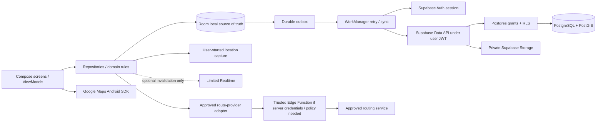

# FIELD EYE V1 — Technical Architecture and Feasibility

**Status:** Draft for independent review and project-owner approval
**Project phase:** PRE-DEVELOPMENT — TECHNICAL ARCHITECTURE REVIEW
**Prepared:** 13 November 2026
**Scope:** Architecture and feasibility documentation only. This document does not authorize an Android implementation, Supabase project/schema, Google Cloud configuration, service activation, deployment, paid API use, or credential creation.

## Decision status and interpretation

This document separates supplied decisions from engineering recommendations and unresolved approvals. A recommendation is not an owner decision. No schema, API contract, permission, data retention period, provider, or implementation detail becomes approved merely by appearing here.

- **Already approved / specified:** owner-provided direction or requirement, as listed in the existing product brief and the new owner-provided architecture assignment.
- **Recommended:** a proposed design to review. It should be adopted only after project-owner approval and detailed implementation review.
- **Unresolved — owner approval required:** a product, privacy, security, provider, or cost choice that this document deliberately does not settle.

The owner-provided assignment states that the V1 UI/UX screenshots and prototype have been reviewed and approved and that the project is moving into architecture. That authorizes architecture research and documentation, not application or backend implementation.

## 1. System architecture

### 1.1 Approved direction and recommended topology

**Already approved / specified:** native Android with Kotlin, Jetpack Compose and MVVM; Room; WorkManager; Google Play services Location APIs; Supabase Auth, PostgreSQL, PostGIS, Storage, limited Realtime and Edge Functions for trusted operations; Google Maps Platform. V1 is for individual agents and private personal records. Local-first session and visit capture, user-controlled tracking, timestamped and accuracy-aware location observations, duplicate-safe synchronization and privacy boundaries are requirements.

**Recommended:** keep the V1 system a small client-server application. Room is the Android read source of truth. Supabase Postgres is the authenticated cloud source of truth after synchronization. A narrow HTTPS/API boundary carries user-scoped data operations. Use Edge Functions only for operations that genuinely require trusted server-side policy, provider credentials, or atomic validation that must not be entrusted to a client. Do not make Realtime part of the correctness path for sync.

The diagram shows logical boundaries, not configured services. It does not imply that project resources, keys, functions, tables, or billing are enabled.

**Why:** Android's recommended offline-first approach keeps the database as the local source of truth and has repositories reconcile local and network sources. Supabase explicitly separates public client keys from server-only secret keys and describes RLS as the row-level authorization layer. A simple, scoped architecture therefore supports offline work without trusting the device with privileged credentials. [1] [4] [13] [14]

### 1.2 Component responsibilities and data flows

- **Compose UI / ViewModels:** render immutable screen state; send user intents to repositories/use cases; expose GPS, sync, freshness and evidence states. No screen calls Supabase, Room DAOs, a map route web service, or provider SDK directly.
- **Domain calculations:** pure deterministic rules for session duration, track-distance derivation, completeness and other owner-approved metrics. Every derived value identifies its source records and method version. Missing inputs remain unavailable rather than becoming zero.
- **Repositories:** coordinate Room and the network; publish Room-backed flows; commit user edits locally; translate server DTOs to local/domain models; manage sync status and conflict visibility.
- **Room:** durable local personal records, cached allowed reference data, sync metadata and outbox. Domain and UI read from Room rather than racing a network response against a local screen.
- **Location capture controller/service:** only starts after an explicit user action and required permission checks. It persists every accepted sample locally before any network attempt. Its visible status is independent of screen navigation.
- **WorkManager:** drains the outbox, retries transient work and optionally uploads queued attachment files. It is not the continuous GPS sampling engine and it cannot promise a precise execution time.
- **Supabase Auth:** identifies the signed-in person and issues the user JWT used by the Data API, Storage and user-authorized functions. An application-level publishable key identifies the mobile app but does not authenticate an individual user. [12] [13]
- **Supabase Postgres/PostGIS:** validates and persists canonical user records; enforces constraints, ownership and geospatial queries through SQL, grants and RLS. The app sends minimal fields and bounded queries.
- **Supabase Storage:** private object store for approved attachments. Each object has a user-scoped path and policy; object metadata is also tracked in a personal `attachments` row. Storage is not made public to simplify downloads. [17]
- **Supabase Edge Functions:** narrow trusted boundary for provider calls, rate limits or cross-row operations that need a server secret. User-facing handlers should validate the user JWT and use a user-RLS-scoped client wherever possible. Any privileged client must explicitly constrain rows to the JWT subject. [18]
- **Realtime:** optional UX invalidation for limited server-originated changes. On reconnect, the client still performs an authenticated reconciliation/query; event delivery does not replace durable sync, idempotency or retry state. Supabase documents per-subscriber authorization and scaling considerations for Postgres Changes. [19]
- **Google Maps Android SDK:** renders a map, markers, polygons, gestures and overlays. It does not itself calculate a route. Route computation is a separate provider adapter behind a reviewed interface. [21] [22]

### 1.3 Recommended request paths

**Personal record sync:** Room outbox → WorkManager → Supabase Data API with the signed-in user's JWT and publishable key → Postgres constraints/RLS. Use the Data API only for narrow authenticated records. Use a dedicated, reviewed RPC/Edge Function for operations requiring atomic multi-row validation or provider secrets; do not create a general-purpose privileged proxy.

**Reference-data read:** bounded query by viewport, time range and result limit, with paging if needed. Cache only content whose provider and license allow local storage. For map viewport queries, use PostGIS spatial predicates/indexes. [16]

**Route request:** `RouteProvider` interface in the app → approved implementation. Before service choice, determine whether route calculation is called directly using a compatible restricted client credential or through a trusted server function. The endpoint must accept only a constrained request model, validate authentication and quotas, select a fixed provider/field mask, and reject arbitrary URLs/fields. Do not forward a Google service key to the app. Policy and storage restrictions for route response data must be reviewed first. [23] [24] [25] [26]

**Attachment upload:** persist file locally and enqueue metadata; upload to a private bucket under an owner-derived path; retry resumable upload for large or interruption-prone files if attachments are approved. Never treat a public URL as authorization. Supabase recommends resumable TUS uploads for large files or unstable connectivity. [27]

## 2. Android application architecture and module boundaries

### 2.1 Presentation and state

**Recommended:** MVVM with unidirectional data flow. Each screen ViewModel exposes a single immutable UI state (including loading/empty/error/evidence/sync values) and accepts explicit UI events. State is derived from repository flows that read Room. One-shot navigation/snackbar effects are separate from durable screen state. ViewModels do not own long-lived location tracking; the session/location component owns that lifecycle and exposes persisted state.

Use Compose navigation destinations for the five approved primary tabs: **Home, Map, Activity, Analytics, Profile**. Registration, login, permission education, place/neighbourhood detail, route planning, active session and visit recording are secondary flows, not new primary tabs.

### 2.2 Module/package boundaries

**Recommended initial modularity:** begin with a small Gradle structure rather than a Gradle module per screen. Android guidance cautions that excessive granularity adds build configuration and maintenance overhead, particularly for small projects. [2]

- `:app` — application entry point, navigation, dependency graph, Compose theme, feature screen packages and ViewModels.
- `:core:model` — platform-neutral record/domain types, evidence states and calculation contracts. Do not duplicate Room entities as public domain contracts.
- `:core:data` — repository implementations and contracts, local/remote mappers, Supabase transport, sync coordination and error mapping. It may initially be one Gradle module with internal packages `local`, `remote`, `repository` and `sync`.
- `:core:location` — permission state, capture policy, location callback/service boundary and sample validation. It owns no UI navigation.
- `:core:maps` — Google Maps surface adapter, map model mapping and the route-provider interface; provider implementation is injected only after approval.

Keep feature code under `:app` packages initially: `feature.home`, `feature.map`, `feature.activity`, `feature.analytics`, `feature.profile`, `feature.auth`, `feature.session`, `feature.visit`, `feature.search`, `feature.route`. Split a package into a standalone Gradle module only when tests, dependency isolation, build-time, ownership or reuse provides a measured benefit. Room storage may remain in `:core:data` initially; split `:core:database` or `:core:sync` later if needed.

**Dependency rule:** UI → domain/repository interfaces → data implementations → Room/Supabase/provider SDKs. The dependency direction should not make `:core:model` depend on Compose, Android location classes or Supabase DTOs. Cross-screen workflows use use cases only when business logic is shared or nontrivial; do not add an elaborate domain layer by default. [1] [2]

### 2.3 Feasibility notes

- **Feasible in the approved stack:** local persistence, screen state, user-triggered location, post-hoc personal analytics and a retryable network outbox.
- **Feasible after policy/provider design:** continuous user-visible recording while minimized; Google map display; route requests; private media upload; spatial search.
- **Not established:** offline Google basemap tiles, offline route computation, turn-by-turn navigation, a neighbourhood boundary source, reliable network signal metrics across Android devices/carriers, or a defensible opportunity score. Treat these as excluded from V1 claims until separately verified.
- **Supabase Kotlin client choice:** select a maintained Kotlin client or a small HTTP/Data API client after compatibility, security, session-refresh and lifecycle evaluation. Do not assume that all Supabase JS features or APIs have a one-to-one native Kotlin implementation. The project has approved Supabase as backend, not a specific Android SDK.

## 3. Data model

### 3.1 General storage rules

**Recommended:** generate stable UUIDs on-device before a record is queued. Use `uuid` primary keys in Postgres and the same string/UUID locally. Use UTC instants (`timestamptz`) for wall-clock events, preserve source/capture timestamps separately from server receipt timestamps, and retain reported location accuracy in metres. Store geographic points as `extensions.geography(Point, 4326)` when distance-on-Earth semantics are required; use `geometry` only for explicitly projected planar operations. PostGIS provides indexable spatial types and GiST spatial indexes; Supabase recommends installing PostGIS into a dedicated schema such as `extensions`, not `public`. [16]

Personal rows carry a non-null `owner_id uuid` referencing `auth.users(id)`, except for explicitly shared, provider-licensed reference datasets. Use a database uniqueness/foreign-key strategy that prevents a child from referencing a parent belonging to another owner. Define `created_at` and `updated_at`; for observations also define `captured_at` and server `received_at`. Never conflate client capture time with cloud receipt time. Store explicit data-quality/status fields rather than fake values.

Room has local `sync_state` (`local_only`, `pending`, `syncing`, `synced`, `retry_required`, `conflict`, `blocked_auth`), `last_sync_error_code` and a monotonic local revision. These operational fields do not have to be mirrored into canonical cloud records. The cloud schema should be designed through migrations only after approval; this document creates no DDL.

### 3.2 Proposed entities and important fields

- **`profiles`** — `id uuid` primary key and foreign key to `auth.users(id)`; display name and optional user-entered profile values; created/updated timestamps. Keep authentication secrets and server-managed Auth attributes out of this table. Do not use editable user metadata for authorization. Supabase documents that `auth.users` is not exposed through the Data API and recommends a separate RLS-protected public profile row keyed to the Auth user. [12] [15]
- **`user_settings`** — `owner_id uuid` primary key; theme/map preferences; approved sampling preferences; settings schema version; updated timestamp. Keep permission grants and runtime service state in Android's platform state, not as claims in this table.
- **`neighborhoods`** — shared reference record if a dataset is approved: dataset/source ID, source version, source attribution/license, stable neighborhood key, display label, `boundary extensions.geometry(MultiPolygon, 4326)` or appropriate geometry, source effective time and import time. It is not user-owned if globally licensed reference content. Limit client access to reviewed read-only columns/functions. Dataset choice and license are blockers.
- **`places`** — for V1, recommend user-owned saved places: `id`, `owner_id`, label, optional user note/category, optional `location geography(Point,4326)`, reported input accuracy/source, captured/created/updated times, optional external provider ID only if its terms allow retention. Keep provider-supplied place content distinct from user-authored notes and user-saved references. Whether external search results can be saved is provider/terms-dependent.
- **`field_sessions`** — `id`, `owner_id`, status (`recording`, `paused`, `completed`, optionally `interrupted`), start/end wall-clock timestamps, accumulated active duration, optional chosen `route_plan_id`, device/session provenance, finalization revision, created/updated timestamps. No server-generated session ID is required for locally started capture.
- **`location_samples`** — `id`, `owner_id`, `field_session_id`, `captured_at`, optional device monotonic elapsed-realtime value and boot/session discriminator, `position geography(Point,4326)`, required `horizontal_accuracy_m`, optional altitude/vertical accuracy/speed/bearing only when supplied and meaningful, source/provider and validation flags. Append-only by recommendation; do not thin or mutate the raw sample stream silently. Retention and sample frequency are owner decisions.
- **`visits`** — `id`, `owner_id`, optional `field_session_id` and `place_id`, `recorded_at`, optional visit start/end only if approved, optional location and accuracy/time provenance, user-entered outcome code only after vocabulary approval, notes, record revision and timestamps. Saving offline must not depend on network. Sensitive notes are never copied into logs.
- **`route_plans`** — `id`, `owner_id`, user-intended origin/destination references or coordinates, travel mode, selected route label and status. Provider, request time, estimate, distance/duration, route labels and geometry are response content: keep them in transient screen state by default and persist only fields that a current terms review explicitly permits. If retention is permitted, include provider, retrieval time, freshness and provenance. Google Maps content caching is restricted; place IDs have a specific exception, but that does not establish retention rights for other response fields. [23]
- **`route_points`** — recommended V1 meaning: user-entered ordered waypoints for a saved route plan (`id`, `owner_id`, `route_plan_id`, sequence index, point kind, coordinate/place reference). Do not store the provider-returned encoded polyline here by default. Render a returned route transiently unless a current license review explicitly permits persistence. Raw recorded GPS belongs in `location_samples`; calculated/simplified tracks are derived data and should be separately named/versioned if later needed.
- **`network_measurements`** — `id`, `owner_id`, optional session ID, `measured_at`, optional location and horizontal accuracy, device/network context only to the extent the Android API and privacy review permit, individual nullable metrics with units (e.g., `signal_dbm`, `download_bps`, `upload_bps`, `latency_ms`, `packet_loss_fraction`), source/test method and consent/state metadata. Null means unavailable/unmeasured, never zero. Network identifiers can be sensitive; minimize collection.
- **`opportunity_assessments`** — future-only derived record: `id`, `owner_id` or explicit dataset scope, subject geography/neighbourhood key, nullable score, evidence state, method/version, assessment timestamp, input record/dataset references and explanation. **Recommendation:** do not calculate or expose V1 opportunity scores until the owner approves the outcome, inputs, weighting, minimum-data rule, freshness, validation and explanation. This table is a shape to review, not authorization to build a scoring feature.
- **`attachments`** — `id`, `owner_id`, parent visit/session, storage bucket/path, media type/byte size/checksum if approved, client-created/uploaded times, local/upload/synced/failed state, and deletion marker. No public bucket, public URL, or unrestricted user-controlled storage path. File binaries are distinct from database metadata; backup coverage must account for them separately. [17] [20]

### 3.3 Important relationships and indexes

- `profiles.id` and `user_settings.owner_id` identify the Auth user.
- `field_sessions.owner_id` owns its `location_samples`, visits and any user route plan. Enforce same-owner parent/child relationships at the database boundary, not only in client code.
- `visits.place_id` is nullable. Deleting a saved place should not silently delete visit history; define `ON DELETE SET NULL` or archival behavior after product approval.
- Shared `neighborhoods` are reference rows; user-owned activity links to a stable dataset key/version rather than changing shared geometry.
- Add B-tree indexes beginning with `owner_id` on personal tables and composite indexes for common owner/time reads (e.g. owner + captured/recorded time). Add `(field_session_id, captured_at)` for sample reconstruction. Add GiST indexes to geometry/geography used in bounding-box, containment or radius queries. Index columns used by RLS predicates; Supabase documents that policy filter columns without suitable indexes can force scans. [14] [16]
- Use a unique constraint on stable client UUID. If account-scoped idempotency is needed, use an explicit `(owner_id, id)` uniqueness/reference design and server-side validation.
- Add check constraints for valid status enums, finite/nonnegative accuracy, valid duration ordering and metric units/ranges where defensible. Avoid constraints that reject legitimate device variation without validation evidence.
- Use keyset pagination for large activity/sample reads and a bounded time/window or viewport for maps; never request the whole location history just to display a viewport.

## 4. Offline-first synchronization and conflict handling

### 4.1 Local write and outbox

**Recommended:** every user action first commits both the local domain record and its outbox operation in one Room transaction. The UI acknowledges “Saved on this device” only after that transaction succeeds. Network failure changes sync state, not the record's existence.

Proposed outbox row fields: `operation_id UUID`, `owner_id UUID`, `entity_type`, `entity_id UUID`, `operation_kind`, `payload_version`, `local_revision`, `created_at`, `attempt_count`, `next_attempt_at`, `state`, and a bounded non-sensitive error code. Store either a reference to the Room row or a versioned payload snapshot; decide during implementation to avoid a payload drifting while queued. Do not put auth tokens, secrets or large binaries in the outbox payload.

On reconnect or explicit retry, enqueue a uniquely named WorkManager sync task for the active account, for example `field-eye-sync:<user-id>`. WorkManager unique work avoids duplicate work chains and supports explicit KEEP/REPLACE/APPEND policies; network constraints, retries and backoff are available. Worker execution can be delayed or stopped when constraints change, so correctness must not assume immediate or uninterrupted execution. [5] [6]

### 4.2 Proposed synchronization sequence

1. Check current authenticated user and compare it to the outbox's `owner_id`. Never send one account's pending rows with another account's JWT. If signed out/expired, mark or leave work `blocked_auth` and prompt the user to reauthenticate.
2. Claim a bounded batch in deterministic order. Parent rows (session, place or route plan) precede dependent rows; attachments follow their parent metadata as a separate resumable phase.
3. Send only the minimum versioned fields using the user JWT and publishable key. The database must derive or validate ownership from the JWT; never trust a client-supplied owner ID without an RLS `WITH CHECK` and appropriate constraint.
4. Use the stable client UUID as the idempotency identity. If the network drops after server commit but before acknowledgement, a retry must resolve to the same record, not create a duplicate.
5. Return canonical server identifiers, revision/updated time and validation state. In a Room transaction, mark acknowledged operations synced and store server metadata.
6. For conflicts or validation failures, preserve local data, retain both relevant revisions where possible, and surface an actionable review state. Do not silently overwrite raw measurements or user notes.
7. Reconcile bounded remote changes after sync or login. Realtime may prompt a refresh but is not a complete replay log or offline queue.

### 4.3 Idempotency contract and server behavior

Stable UUID plus unique constraints is necessary but not sufficient if retries can overwrite a newer record. **Recommended contract:**

- Location samples and finalized event records are append-only; repeating the same ID and same canonical payload is acknowledged as already applied.
- Reusing an ID with materially different immutable payload is a conflict, not a silent overwrite.
- Mutable records carry `revision` or an equivalent version. Updates include the version the client read; the server rejects stale revisions and returns the canonical row/version for explicit resolution.
- The owner identity comes from the validated user JWT (`auth.uid()`), and server checks prevent changing an existing row's owner.
- If a future sync batch must atomically save a session plus many children, expose a narrow database RPC or authenticated Edge Function with per-row validation and transaction semantics. Do not assume a series of REST requests is one atomic transaction.

This is a **recommendation**, not an existing Supabase implementation. Exact Upsert/RPC behavior, payload size, batch size and API contract must be verified in an approved local test environment before production.

### 4.4 Conflict policy

**Recommended:** avoid blanket “last write wins.” Append-only observations need no merge. For user-editable notes/settings, use explicit optimistic version checks and either a field-safe merge or a visible conflict screen. Session lifecycle transitions are constrained and server-validated; a pause/end from one device must not be undone by an old queued “recording” update from another.

**Unresolved:** whether V1 guarantees one active device per account, whether users may edit/delete an already synced visit, whether a completed session is immutable, what delete/tombstone semantics apply, and what the user sees when two devices edit the same record. Resolve these before sync contract sign-off.

### 4.5 Retry and error taxonomy

- Retry transient DNS/connection failures, timeouts, HTTP 408/429 and recoverable 5xx with exponential backoff plus bounded jitter and a per-operation maximum/alert state.
- Do not automatically retry malformed payload/validation failures, forbidden RLS writes, unsupported schemas, invalid provider responses or permanent 4xx errors. Mark them blocked and retain user data.
- On 401, attempt the supported user-session refresh once if safe; if not, pause queue until interactive reauthentication. Never route through a service key to “fix” a user token.
- On 409/version conflict, fetch canonical revision and open conflict resolution; do not blindly retry the same stale update.
- WorkManager constraints may interrupt an operation. Each step must be restartable and safely idempotent. Observe and expose pending count/last error category; do not claim “Synced” until the server acknowledgement has been committed locally. [4] [5] [6]

### 4.6 Account switching, sign-out and deletion

The local store should tag every personal row and outbox item with the Auth user UUID. Worker authorization is checked per row, not inferred from whichever account is currently open. Avoid a multi-account local database by default unless product approves it. On sign-out, do not silently delete unsynced records. Offer a warning and owner-approved choices (keep encrypted locally for the same account, sync before sign-out, export, or delete). Clear in-memory credentials on sign-out while preserving/auditing pending data according to the approved retention policy.

Account deletion needs coordinated Auth, relational rows and Storage object deletion. Supabase Auth user deletion does not remove Storage objects automatically and an existing JWT can remain valid until expiry; privileged deletion should run through a narrowly authorized administrative flow, not a client-side service key. [15]

## 5. Authentication, authorization, storage and threat boundaries

### 5.1 Threat model summary

The app handles exact routes and location histories, visit notes, saved places, network observations, and possibly photos. Treat these as sensitive personal data. Threats include a lost/unlocked device, account switching, stolen access token, leaked API key, malicious client modifying owner IDs or timestamps, misconfigured RLS/grants, public attachment URLs, overbroad Edge Functions, compromised dependencies, log/analytics leakage, abusive API requests, and accidental cross-user reference/query exposure.

### 5.2 Authentication and client keys

- Use Supabase Auth user sessions. Keep refresh/access token handling in the approved client library or encrypted platform storage; do not log tokens. Re-authentication is required after expiry/revocation.
- A Supabase publishable key may be embedded in a public mobile app, but it is not an authorization mechanism. Every data table/function/storage object remains protected with grants and RLS. Current Supabase docs say legacy `anon`/`service_role` keys are being deprecated by the end of 2026; use current publishable/secret terminology when implementation is approved. [13]
- Never ship a Supabase secret/service-role key, Postgres password, Google Routes web-service key, service account key or other privileged credential. Keep secrets in a trusted server/Edge Function secret store and rotate if exposed. [13] [18]
- Google Maps SDK key in an Android binary is extractable, so treat it as public-but-restricted, not a secret. Restrict it by Android package name + signing certificate fingerprint and by the exact SDK/API. Use separate debug/release keys, usage monitoring and quotas; never share a general unrestricted key between native Maps and web-service APIs. [23]

### 5.3 Database authorization

**Recommended baseline:**

- Enable RLS on every exposed personal table and write separate, explicit SELECT/INSERT/UPDATE/DELETE policies for `authenticated` as needed.
- Row condition is `owner_id = auth.uid()`; inserts and updates use `WITH CHECK` so a user cannot assign or transfer a row to another account. Parent/child checks validate that referenced session/place/route rows belong to the same owner.
- Grant only the necessary SQL operations and columns to the exposed roles. Grants determine whether the role can reach an object; RLS limits which rows. Supabase warns that default object grants can expose new objects through the Data API; prefer deliberate exposure and review defaults on any future project. [14] [15]
- Keep reference data and internal functions in non-public schemas where appropriate. If views are exposed, use a safe invoker-security model where supported; review `SECURITY DEFINER` functions for fixed `search_path`, explicit grants and caller validation.
- Do not base authorization on editable user metadata. Use the signed JWT subject/Auth UID or server-controlled app metadata as appropriate. [12] [14]
- Add indexes for RLS columns and add RLS policy tests for each CRUD path, two distinct users, unauthenticated access, cross-user parent IDs and update-owner reassignment. Test failure modes as well as successful reads/writes.

### 5.4 Edge Function boundary

Use an Edge Function only when the operation requires a trusted secret, provider mediation, request throttling or a carefully controlled atomic workflow. For a signed-in user endpoint, validate the JWT and prefer a user-scoped Supabase client that remains subject to RLS. If service-role/admin context is unavoidable, validate all identifiers against the caller's JWT subject in the function and minimize the operations possible. Default-deny; use explicit auth modes; retain JWT verification for user calls. Do not build a universal `/proxy?url=` or client-specified SQL endpoint. [18]

### 5.5 Storage policy

Use private buckets. Paths should be generated from authenticated owner UUID and attachment UUID, not a user-provided arbitrary path. Policies should constrain owner, bucket, operation and parent record. Downloads should use the authenticated Storage API or short-lived signed URLs after access authorization. Validate content type, size and file ownership; define deletion/retention and malware/content handling if attachments are enabled. Resumable uploads can improve reliability but do not change authorization requirements. [17] [27]

## 6. Location capture, permissions, lifecycle and battery

### 6.1 Permission model

**Platform facts:** Android separates foreground/background location and approximate/precise accuracy. Apps should continue to function with approximate access unless a feature truly requires precision. A location foreground service gives user-visible ongoing access via a persistent notification; Android 10+ requires declaring the `location` service type. Android 14-targeting apps must declare the relevant foreground-service type permission and meet runtime prerequisites; location permission and enabled device location are checked before starting. A location foreground service cannot be started from background with only while-in-use permission unless background location is granted. [7] [8]

**Recommended V1 permission sequence:**

1. No permission request on splash, onboarding, registration, login, Home display, analytics, or text search.
2. When a user taps a location-dependent control, explain the specific reason. Request foreground coarse and fine together only if the feature's approved need justifies precise access; handle approximate as a valid degraded state.
3. For active capture, explain what is saved and that tracking is active. Request/grant required foreground permission while the activity is visible, confirm system location is enabled, then start the location foreground service with a persistent notification. Keep Start/Pause/Resume/Stop visible in app and notification; Stop actually stops location updates.
4. **Do not request `ACCESS_BACKGROUND_LOCATION` by default.** If owner approves automatic start or location access outside an active user-started foreground session, document the necessary use case, prominent disclosure, policy review, and Play declaration before implementation. Google Play requires background location to be core-feature justified and reviewed; it calls for prominent disclosure and submission documentation. [10]

**Unresolved:** whether recording must continue when the app is minimized or screen is locked; whether precise access is needed for all route recording or only selected features; Android minimum/target SDK at implementation; notification actions and behavior after process/service termination.

**Recommendation requiring owner decision:** support continuing a deliberately started session with the screen locked through a location foreground service, but do not add always-on/background permission or background-start capability in V1. This remains subject to product and Play-policy review.

### 6.2 Sampling and accuracy

Use Google Play services Fused Location Provider because it combines available signals and supports request priority, interval, minimum interval and batching behavior. Android documents a battery trade-off: higher precision, shorter intervals and lower delivery latency consume more power; balanced/low-power settings suit many uses, while high accuracy is for foreground real-time use. Batch delivery can reduce power when immediate updates are unnecessary. [9]

**Recommended policy (parameters require field validation):**

- Idle/no session: no continuous updates. Use a single current/last-known position only after a user action, clearly show its capture time and accuracy, and do not treat it as current when stale.
- Active tracking: use a foreground-service request appropriate to actual field movement and location quality. Start with a balanced/quality policy; adapt interval/priority based on movement, session state, battery saver and explicit user mode. Avoid a fixed high-rate GPS loop independent of motion.
- Persist original provider timestamp, receive/persist timestamp, horizontal accuracy, coordinates, session ID and available provider/provenance. Keep any raw sample that the accepted sampling rule admits. Do not replace poor GPS with a snapped-to-road point in the raw table.
- Validate impossible timestamps, duplicate callbacks, non-finite coordinates, poor accuracy and large jumps; retain valid raw evidence with quality flags rather than quietly rewriting coordinates. Derived track filters and distance are separately versioned.
- Avoid storing device identifiers or network/carrier identifiers unless the approved metric needs them.

Sampling interval, minimum useful accuracy, max-gap policy, acceptable track-distance treatment and user-exposed sampling controls are not set here. Define them through battery and field tests before release; do not hardcode speculative thresholds into requirements.

### 6.3 Session lifecycle

Model a session state machine separately from sync state:

`idle → recording ↔ paused → completed`

A failed/killed service can transition to a visible `interrupted` recovery state if approved. Starting and resuming are explicit user actions. Pausing stops location requests but preserves session identity and elapsed-active duration. Ending stops updates, finalizes timestamps and produces a summary from recorded observations only. A route estimate remains separate from the recorded GPS track.

For duration, preserve wall-clock start/end instants and use monotonic elapsed-time measurements for in-device active duration where available, accumulated across pauses; wall-clock changes must not manufacture elapsed time. If capture is interrupted, do not infer samples for the gap. On app restart, reconcile persisted state with service state and display “tracking stopped/interrupted” when that is what happened.

### 6.4 Foreground service versus WorkManager

A location foreground service is the appropriate mechanism for an ongoing user-visible location session; WorkManager is for deferrable/retryable sync and uploads. Android guidance explicitly directs work without an appropriate long-running FGS type toward WorkManager or user-initiated transfer jobs. Do not use a WorkManager worker as a hidden continuous GPS tracker. [8]

## 7. Maps, geospatial queries, route computation and cost

### 7.1 Maps display and evidence layers

Google Maps SDK for Android supports a map view, gestures, markers, polygons and overlays. Cloud-based styling supports map feature visibility/color and light/dark map styles using a configured map ID. It requires Google Cloud setup; no map ID or style is created at this stage. [21] [22]

Render provider basemap separately from FIELD EYE overlays: user position with accuracy cue; saved places; approved neighbourhood boundaries; observed network measurements; selected route plan (solid) and recorded track (dashed). Every sourced overlay has source, time/freshness and evidence status. Sparse network readings remain points; do not interpolate a provider-coverage heat map unless a validated method/source is approved. Keep Google/third-party attribution visible and respect styling/terms. [23]

Offline behavior must be honest: Room can show personal records in a list and may show permitted locally stored geometry, but this architecture does not promise offline basemap tiles, geocoding or route results. Decide provider terms and test offline behavior before making the UX claim.

### 7.2 Geospatial data and PostGIS

Use PostGIS `geography(Point,4326)` for GPS observations and user place points that need geodesic distance/radius semantics; use polygons/multipolygons for neighbourhood boundaries with declared source CRS. Create GiST spatial indexes. Use bounded queries for map viewport (`bbox` intersects) and radius search. For nearest-neighbour, use an index-aware ordering/query pattern and validate units. Supabase's PostGIS guide demonstrates `geography`, GiST indexes and bounding-box/distance query functions, and recommends installing the extension in a dedicated `extensions` schema. [16]

Place geospatial RPCs behind narrow named functions if the query needs PostGIS functions not cleanly representable by the client API. Set a safe `search_path`, bound result count and extent, use user identity for personal records, and grant execute to only the intended roles. Do not return raw location histories without a bounded owner-scoped purpose.

### 7.3 Route provider decision

**Already unresolved:** route computation provider/service. Google Maps Platform is approved direction for maps, but that does not automatically approve Routes API, route modes, Navigation SDK, Places APIs, cost, or terms.

**Recommended V1 evaluation order:**

1. Validate only the minimum user journey: origin + destination, a walking/driving mode only if chosen, one displayed estimate, explicit provider/time label, and Start session. Do not build turn-by-turn guidance or multi-stop optimization by implication.
2. Compare Google Routes API with at least one feasible alternative using geographic coverage, route quality, data licensing/cache restrictions, map-provider compatibility, route modes, latency, privacy/data transfers, cost per expected active agent, key restrictions and operational burden. No provider is selected here.
3. If Google Routes is selected, request only required fields with `X-Goog-FieldMask`; there is no default field list, and field masks reduce response payload and unnecessary processing/billing. Alternatives can be requested (up to three in addition to default) but may be absent and cannot be requested when intermediate waypoints are present. [24] [25]
4. Keep provider results labeled `Estimated`; distinguish them from subsequent raw GPS and calculated actual distance. Keep response-derived route values and polylines transient unless current terms expressly permit storage; place IDs have a stated storage exception, while most content is subject to caching restrictions. Route data shown on a map must satisfy Google attribution and display requirements. [23]
5. Do not generate a fake route line, claim alternative availability, infer turn-by-turn instructions, or claim offline routing.

### 7.4 API-key and cost control

Use distinct restricted credentials for Maps SDK and any server route provider. Restrict the native SDK credential to package name + signing fingerprint and only the Maps SDK. For a Google web service called from a server, use a server-only credential restricted to the applicable service and server network; do not place it in the APK. Google recommends a secure proxy when calling web services from client apps if application restrictions cannot be reliably enforced. [23]

Cost guardrails before any service activation: select a billing owner and hard per-API daily quotas appropriate to an approved budget; set alerts/usage dashboards; use request debouncing, viewport bounds, caching only when terms permit, minimal field masks, pagination and one map instance where possible. Quotas can cap usage; billing budgets/alerts notify but are not a hard spending cap. Routes calls are billed by request, while route matrix is billed by returned element; feature selection can change the SKU. Current price/allowance values are deliberately not copied into this architecture because they change and no project usage forecast/billing country has been approved. [25] [26] [28]

**No-bill boundary:** this architecture task activated no API, created no credentials or map ID, set no quota, submitted no paid request and incurred no provider charges.

## 8. Analytics and calculation rules

### 8.1 Provenance and evidence vocabulary

Use the approved evidence states exactly: **Observed**, **Estimated**, **Stale**, **Unavailable**. Do not use “Predicted” as a synonym for Estimated. Store raw observations separately from derived values. Each derived record or displayed metric should expose calculation method/version, observation/source IDs, calculation time, applicable time window and quality/completeness state.

A null/absent value is not zero. Show zero only when a complete query for the selected scope establishes a true count or sum of zero. If permissions, missing samples, pending sync or gaps make the result incomplete, show the value as partial/unavailable with a reason rather than inventing a number.

### 8.2 Deterministic V1 metrics

- **Elapsed field time:** sum active intervals from session state transitions using monotonic duration while a device session is running; preserve UTC event instants for audit. Exclude paused intervals. Interrupted intervals are not assumed active.
- **Recorded distance:** compute from accepted sequential raw GPS samples using an explicitly versioned geodesic method, honoring reported accuracy and large gaps. Keep raw points unchanged. Display “Recorded / calculated from GPS samples,” sample count, range and data-quality note. Never equate planned route estimate and observed route distance.
- **Visit count:** count records in the selected range with a clear sync-completeness indicator. Pending local visits are included in personal on-device activity but marked pending.
- **Route estimate:** provider-reported estimate with provider timestamp and returned mode; does not become a recorded value.
- **Network observations:** preserve raw measurements with units and source. A sparse point set cannot support a coverage percentage or interpolation absent a separately validated method and threshold.
- **Opportunity score:** not a V1 default. If approved later, assessment must include algorithm version, input snapshot, evidence, freshness, confidence/limitations, and explainability; deterministic baseline and outcome validation before AI. Google AI/Gemini is an approved future direction only, not needed for this architecture milestone.

### 8.3 Calculation and testability

Calculations live in pure domain functions with fixtures for edge cases: gaps, duplicate samples, poor accuracy, out-of-order sample times, clock changes, paused sessions, partial sync, missing routes and zero-complete data. Unit/contract tests verify deterministic output and the provenance label. Recompute derived summaries from retained raw inputs only if policy permits; record algorithm version so a method change is auditable.

## 9. Error handling, observability, backup/recovery and privacy

### 9.1 Error surface

Provide a typed error model separating offline/timeout, auth expired, permission denied, device location disabled, validation failure, RLS/forbidden, rate limit, provider unavailable, conflict, storage upload failure, and unknown service error. Each user-facing error states what remains saved locally and the next available action. Avoid raw SQL/provider responses in the UI.

A failed location request must leave capture state explicit; it must not display GPS data as current. A route provider failure must leave route estimate unavailable. A sync failure must preserve the Room row and retry state. A Storage upload failure must keep a recoverable local file reference until deletion/retention rules say otherwise.

### 9.2 Observability

**Recommended:** structured, privacy-minimized diagnostics containing operation class, record type, app/schema version, coarse error category, queue age/size, retry count, HTTP status and non-sensitive correlation ID. Never log coordinates, route polylines, visit notes, raw network IDs, access/refresh tokens, API keys or attachment contents. Avoid installing third-party analytics/crash reporting until purpose, consent/disclosure, data region, retention and vendor access have been reviewed. Error reporting should distinguish user-visible incidents from routine offline periods.

Metrics to define before release: sync success/failure and age distribution; local save failures; session service start/stop/interruption rates; location accuracy/age distributions (aggregated and privacy-reviewed); battery drain in scripted field scenarios; route request volume/cost; attachment queue states; crash-free sessions. Do not upload precise diagnostics solely to measure product engagement without approval.

### 9.3 Device backup and local recovery

Android Auto Backup includes most app-private files and databases by default for eligible apps, with a 25 MB per-app-user allowance. Developers can configure file inclusion/exclusion. That creates a design choice: restoring a Room database containing sensitive location data may be convenient but can restore stale queue/session state or separate the database from a Storage object/server record. [11]

**Recommendation:** define explicit Android backup/extraction rules before implementation. Exclude credentials, transient worker state and resumable upload tokens. Decide separately whether unsynced field records and personal location history are included; if included, make restore reconcile IDs against the signed-in account and server before uploading. Do not rely on Android backup as the only copy of unsynced critical work.

**Unresolved:** local encryption-at-rest design, Android backup inclusion for unsynced records, retention after sign-out/account deletion, export format, delete cascade, user data residency and lawful retention. A local database encryption library/key lifecycle adds dependency and recovery trade-offs; select it only after threat-model and recovery review. Device compromise/root access cannot be treated as solved by RLS.

### 9.4 Supabase backup/recovery

Supabase documents that database backups do not include Storage API binary objects. Backup availability/retention depends on plan; the documented daily backup tiers and PITR are service/plan-dependent, and PITR is an additional cost. Restores make the project unavailable while restoring. These facts mean database backup alone is not an attachment-recovery plan. [20]

Before production, choose numeric recovery point objective (RPO) and recovery time objective (RTO), a plan/budget, an off-site export strategy if required, and a separate Storage-object retention/backup process. Perform a restore exercise that verifies database, Storage references and actual objects together. Do not enable PITR or create a Supabase project in this architecture task.

### 9.5 Privacy and retention

Collect location only after user action and only for a feature that needs it. Request foreground first. Minimize precision, frequency, retention, attachment metadata and network identifiers. Keep personal and reference data separate. Explain capture state and sync state; offer user-visible export/deletion pathways only after their semantics are approved. Define what deleting a session means for samples, visits, route plans, derived analytics and backups. Device-side deletion, cloud deletion, backup expiry and Storage-object deletion may have different timelines; disclose them honestly.

Jurisdiction, data residency, privacy notice wording, processor/vendor terms and applicable regulatory analysis require owner/legal review; this document is not legal advice and does not select a region.

## 10. Phased implementation roadmap and measurable acceptance criteria

No phase below authorizes implementation by itself. Each phase begins only after the architecture and that phase's scope are approved. Acceptance criteria are proposed review gates; numeric product targets require owner sign-off where indicated.

### Phase 0 — Architecture decisions and test plan

**Dependencies:** owner review of this document.
**Exit criteria:** record each decision as approved/deferred; resolve session background behavior, account/device assumptions, visit semantics, retention/deletion, route/map provider, data region, attachment scope and RPO/RTO; define location/battery and sync failure test matrix; approve API budget before any provider configuration. No cloud resources created.

### Phase 1 — Native shell and local domain model

**Scope after approval:** Kotlin/Compose navigation, MVVM state, Room schema/migrations, repositories, personal model and evidence vocabulary. No production backend integration.
**Exit criteria:** all five approved tabs navigate; screen state recovers from activity/process recreation where expected; offline-created session/visit remains after process restart; Room migration tests pass from every released schema fixture; database schema exports are versioned; unit tests prove absent data is not zero and raw samples are not mutated; no secrets in repository.

Keep migration paths explicit and tested, retain versioned exported schemas in source control, and avoid destructive fallback where existing field records would be lost. [3]

### Phase 2 — Local session and visit capture

**Dependencies:** approved lifecycle, precise/approximate needs, sample policy and consent wording.
**Scope after approval:** permission education, Fused Location Provider, visible session lifecycle, location foreground service only if the approved session flow requires it, Room sample persistence, pause/end, local visit entry.
**Exit criteria:** permission denied/approximate/precise/system location off scenarios produce correct states; explicit Start is required; Stop prevents new samples; sample records preserve captured timestamp and accuracy; service/notification matches active state; pause excludes duration and capture; process/service interruption is visible and never interpolated; battery profile is measured on agreed representative devices and the owner approves a target before release; Play policy review completed if background permission is proposed.

### Phase 3 — Supabase schema and security (separate approval gate)

**Dependencies:** owner approval of model, data region/provider, RLS and retention.
**Scope after approval:** version-controlled SQL migrations, Auth integration, user-owned tables, PostGIS extension/schema, minimal grants/RLS, private Storage policies only if attachments approved.
**Exit criteria:** automated RLS tests prove user A cannot read/write user B rows, reassign ownership, access another user's child row or storage object; unauthenticated requests fail; indexes cover owner/RLS and geospatial queries; no secret key is present in client build/repo; project backup and deletion policies are understood. No schema or resource is authorized by this draft.

### Phase 4 — Duplicate-safe sync and account lifecycle

**Dependencies:** approved conflict/delete/sign-out semantics and API contract.
**Scope after approval:** Room outbox, unique WorkManager workers, Supabase user-scoped upserts/RPC, revision conflicts, auth pause/resume, bounded reconciliation.
**Exit criteria:** replaying the same outbox operation 10 times yields one canonical record; injected timeout after server commit is recoverable without duplicate; worker reschedules on transient errors and stops on permanent auth/validation errors; changing account never uploads another account's pending data; concurrent stale update is rejected/visible; local data remains available offline and “synced” appears only after acknowledgement. The exact test count/scale can be adjusted during implementation planning.

### Phase 5 — Maps, search and route feasibility

**Dependencies:** selected provider, data licensing, account billing owner, cost ceiling and API terms.
**Scope after approval:** restricted Android Maps key/map ID, approved map overlays, bounded PostGIS search, route provider adapter and minimal route estimate.
**Exit criteria:** Maps key is restricted to package/certificate and APIs; route key never ships in APK; unauthorized API restriction test fails closed; daily quotas and alerts exist before billing-enabled tests; request count and cost per active-agent scenario documented; route estimates show provider/source/time and are not mixed with GPS track; test with no route, no alternatives, no network, stale response and denied permission; offline copy claims match observed provider behavior.

### Phase 6 — Analytics, attachments and operational readiness

**Dependencies:** approved outcome vocabulary, calculation definitions, attachment scope/retention, backup/RPO/RTO and privacy disclosures.
**Scope after approval:** deterministic summaries, private attachments, diagnostics, export/delete, recovery runbook and accessibility hardening.
**Exit criteria:** calculation tests cover missing/outlier/gap/paused data and expose method version; coverage displays only with validated evidence; attachment authorization and DB/object deletion tests pass; backup restore exercise meets approved RPO/RTO; no personal location/notes/secrets in logs; TalkBack, large fonts, contrast, touch size and representative field-use tests meet owner-approved criteria.

## 11. Significant decisions and approval register

### Already approved / specified

- Native Android Kotlin + Compose + MVVM; Room; WorkManager; Google Play services Location APIs.
- Supabase Auth/PostgreSQL/PostGIS/Storage, limited Realtime, Edge Functions for trusted operations.
- Google Maps Platform as a mapping direction; provider for route computation remains unresolved.
- Individual user accounts and private personal data; no required V1 organizations or supervisor accounts.
- Local-first offline visits and sessions, stable UUIDs, safe retries, visible user-controlled location capture, timestamps and accuracy, adaptive/battery-conscious sampling.
- Raw observations separate from derived calculations; missing values not zero; deterministic calculations preferred.
- Five primary tabs: Home, Map, Activity, Analytics, Profile.
- Approved V1 UI/UX screens/prototype according to the owner-provided 13 November 2026 assignment; architecture is under review, not implementation-approved.

### Recommended, awaiting approval

1. Room is the sole source read by UI; local outbox commit is atomic with user-record save.
2. Use stable client-generated UUIDs and immutable append-only location samples; reject same-ID/different-payload updates as conflicts.
3. Use optimistic revisions for mutable personal records; avoid blanket last-write-wins.
4. Start tracking only from visible user action; if screen-lock continuation is wanted, use a user-started location foreground service; do not request background location or permit background-start by default.
5. Start with package boundaries and a small Gradle module count; split modules only with measured need.
6. Use `geography(Point,4326)` + GiST for earth-distance point data; keep neighborhood reference data versioned/licensed and separate from personal rows; keep PostGIS in dedicated `extensions` schema.
7. Enforce per-user RLS/grants on every exposed personal row and same-owner parent/child links; private Storage only.
8. Keep Realtime advisory/invalidation-only; use explicit reconciliation for correctness.
9. Do not persist Google route response geometry by default; show it transiently subject to terms, and label route estimate separately from raw GPS.
10. Do not release V1 opportunity scoring until method and minimum evidence thresholds are approved and validated.
11. Explicit Android backup rules; do not rely on Auto Backup for sole recovery of local critical data. Define database and object-storage recovery together.
12. Add privacy-minimized structured diagnostics only after telemetry purpose/consent/retention/vendor review.

### Unresolved — owner approval required

- Does a started field session continue recording while the app is minimized or the display locked? Is app termination expected to stop it, and what is the user-visible recovery behavior?
- Which features require precise location, and can approximate location support search/map browsing?
- What are V1's min/target Android versions and accessibility/device support baseline?
- May one account sync from more than one device? Which visit/session fields are editable after sync, and what conflict UI/delete semantics apply?
- What are the canonical visit outcome categories and whether a visit is a point-in-time event or a start/end interval?
- What is location/sample/notes/network/attachment retention; account deletion cascade; export format; unsynced sign-out behavior; Android backup inclusion; local encryption requirement?
- Which route provider/modes, place-search provider, neighbourhood dataset/source/license, boundaries refresh and network-measurement source are acceptable? Are Google Routes API and Places APIs in scope?
- What is the cost ceiling, quota owner, deployment region/data residency and API privacy disclosure? No paid service is enabled.
- Are attachments in V1? If yes, accepted file types/sizes, upload behavior, object deletion and recovery plan?
- Which network measurements are actually supported on target Android devices, and which speed test/consent/data cap apply?
- Is any opportunity assessment included in V1? If so, approve method, evidence threshold, evaluation, freshness and explanation before schema/API design.
- What numeric battery target, sample interval/accuracy/gap thresholds, route-estimate freshness and network-data freshness are required?
- What are RPO/RTO, backup plan budget and restore test cadence?
- Which crash/telemetry provider, if any, is permitted; what diagnostics may leave the device?

## 12. Principal risks and feasibility blockers

- **Location permission/policy risk:** a background permission added without a documented core need can create UX, system-start restrictions and Play review issues. Resolve session behavior before Android service design. [7] [8] [10]
- **Data exposure risk:** a single missing RLS policy, permissive grant, unsafe RPC or public Storage bucket can disclose precise location history. Automated tests must cover all user-owned tables/objects. [14] [15] [17]
- **Offline duplicate/corruption risk:** retries can replay after an uncertain response, and updates from multiple devices can race. Stable identity, immutable event behavior and conflict/version contract must be tested before launch. [4] [5] [6]
- **Provider lock-in/terms risk:** map styling, Routes responses, external place content and neighborhood boundaries have separate license, retention, attribution and billing terms. Keep providers behind interfaces and review data storage before caching. [22] [23] [24]
- **Cost risk:** Maps/Routes billing varies by feature/SKU and a route matrix scales by elements; alerts do not cap all spend. Configure API-specific quotas and a budget before activation. [26] [28]
- **Data-quality risk:** GPS gaps/outliers, stale route estimates, unsupported network metrics or sparse field samples could be mistaken for complete facts. Keep provenance/state attached through calculations and analytics.
- **Local recovery risk:** location data can be included in Android backup by default; cloud DB backups do not include Storage files; losing a device can strand unsynced content. Decide backup/encryption/retention with privacy and product owners. [11] [20]
- **Feasibility blocker — sources and cost are not selected:** neighborhoods, places/search, route calculation, network measurement and attachments require source, terms, supported fields, privacy flow and cost approval. No real integration should be started before that gate.

## References

[1]: https://developer.android.com/topic/architecture "Guide to app architecture"
[2]: https://developer.android.com/topic/modularization "Guide to Android modularization"
[3]: https://developer.android.com/training/data-storage/room/migrating-db-versions "Migrate your Room database"
[4]: https://developer.android.com/topic/architecture/data-layer/offline-first "Build an offline-first app"
[5]: https://developer.android.com/develop/background-work/background-tasks/persistent/getting-started/define-work "Define WorkRequests and retry behavior"
[6]: https://developer.android.com/develop/background-work/background-tasks/persistent/how-to/manage-work "Manage WorkManager tasks and unique work"
[7]: https://developer.android.com/develop/sensors-and-location/location/permissions "Request location permissions"
[8]: https://developer.android.com/about/versions/14/changes/fgs-types-required "Foreground service types are required"
[9]: https://developer.android.com/develop/sensors-and-location/location/battery "About background location and battery life"
[10]: https://support.google.com/googleplay/android-developer/answer/9799150?hl=en "Access location in the background"
[11]: https://developer.android.com/identity/data/autobackup "Back up user data with Auto Backup"
[12]: https://supabase.com/docs/guides/auth/users "Supabase Auth users"
[13]: https://supabase.com/docs/guides/getting-started/api-keys "Supabase API keys"
[14]: https://supabase.com/docs/guides/database/postgres/row-level-security "Row Level Security"
[15]: https://supabase.com/docs/guides/api/securing-your-api "Securing the Supabase Data API"
[16]: https://supabase.com/docs/guides/database/extensions/postgis "PostGIS geo queries"
[17]: https://supabase.com/docs/guides/storage/security/access-control "Supabase Storage access control"
[18]: https://supabase.com/docs/guides/functions/auth "Securing Supabase Edge Functions"
[19]: https://supabase.com/docs/guides/realtime/postgres-changes "Supabase Realtime Postgres Changes"
[20]: https://supabase.com/docs/guides/platform/backups "Supabase database backups and PITR"
[21]: https://developers.google.com/maps/documentation/android-sdk/overview "Maps SDK for Android overview"
[22]: https://developers.google.com/maps/documentation/android-sdk/cloud-customization "Cloud-based maps styling"
[23]: https://developers.google.com/maps/api-security-best-practices "Google Maps Platform security guidance"
[24]: https://developers.google.com/maps/documentation/routes/alternative-routes "Request alternative routes"
[25]: https://developers.google.com/maps/documentation/routes/choose_fields "Choose Routes API response fields"
[26]: https://developers.google.com/maps/documentation/routes/usage-and-billing "Routes API usage and billing"
[27]: https://supabase.com/docs/guides/storage/uploads/resumable-uploads "Supabase resumable uploads"
[28]: https://developers.google.com/maps/billing-and-pricing/manage-costs "Manage Google Maps Platform costs"
